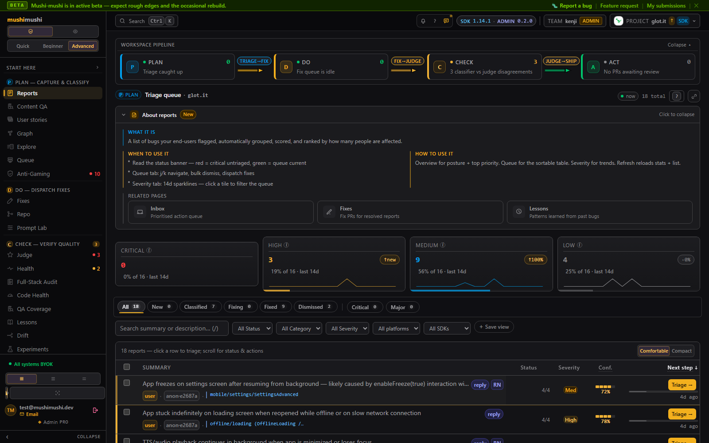
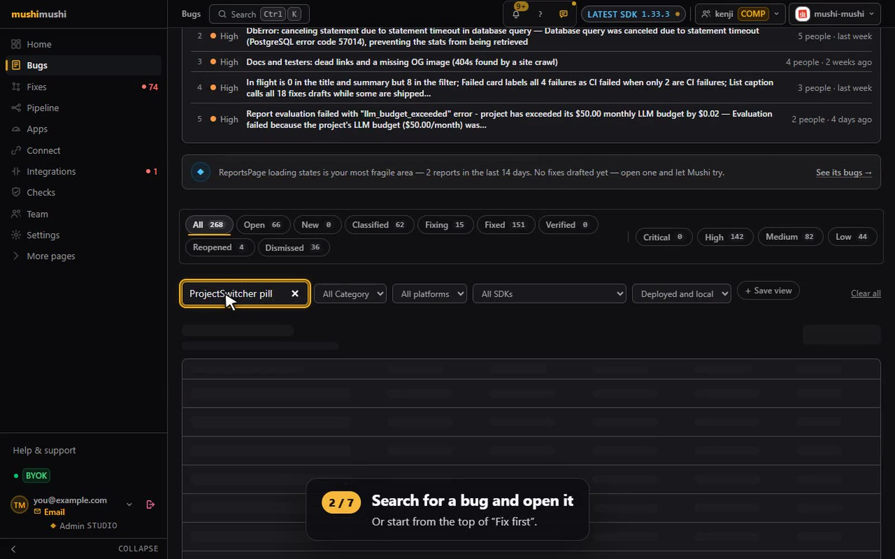
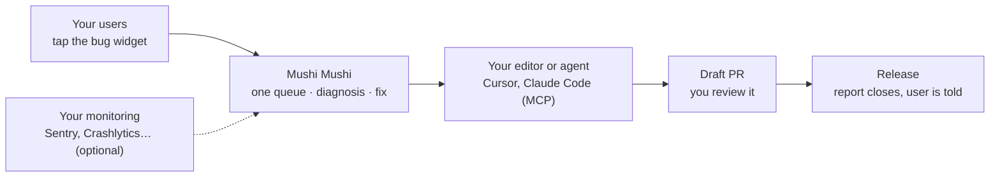

<div align="center">

# Mushi Mushi

**Your AI built it. Mushi Mushi makes it better.**

Mushi Mushi checks your live site, shows where people get stuck, and reviews your code. Your users can tap a button to report a bug. Each problem comes with a plain-English explanation and a fix that Lovable, Cursor or Claude Code can apply.

**Fix what breaks** · **Smooth the journeys people take** · **Clean up the code** — one place, from your editor.

**[Check your live app free →](https://kensaur.us/mushi-mushi/docs/check?src=github-readme)** No sign-up, nothing to install.

**[Add it to Lovable or Bolt with one prompt →](https://kensaur.us/mushi-mushi/docs/quickstart/lovable-bolt)** No terminal, about five minutes, free for one app.

Or, in your app's folder:

```bash
npx mushi-mushi
```

<sub>Built for the vibe coder who ships fast with Cursor, Claude Code, Lovable or Bolt.</sub>

[](https://www.npmjs.com/package/@mushi-mushi/react)
[](./packages/server/LICENSE)
[](https://scorecard.dev/viewer/?uri=github.com/kensaurus/mushi-mushi)
[](./SECURITY.md#verifying-a-mushi-mushi-tarball-before-installing)
[](https://skills.sh/kensaurus/mushi-mushi)

[Quick start](#quick-start) · [How it works](#how-it-works) · [Docs](https://kensaur.us/mushi-mushi/docs/) · [Sample diagnosis](https://kensaur.us/mushi-mushi/docs/demo/diagnosis) · [Why not Sentry?](#why-not-just-sentry) · [Self-host](#self-host) · [Vision](./VISION.md)

<a href="https://kensaur.us/mushi-mushi/docs/demo/diagnosis" title="See a sample diagnosis: no signup">
  
</a>

<sub>↑ reports in the Mushi Mushi console, each with a plain-English summary. Click for one full sample diagnosis you can read without signing up.</sub>

</div>

## How it works

<a href="https://kensaur.us/mushi-mushi/docs/how-it-works" title="Watch the walkthroughs">
  
</a>

<sub>↑ Short videos that show every click: a user reporting a bug, the diagnosis, connecting your editor, and the fix shipping. [Watch them on How it works](https://kensaur.us/mushi-mushi/docs/how-it-works).</sub>



1. **Capture.** A user taps the widget. Mushi Mushi records a screenshot, the route, their note, and the last console and network events.
2. **Diagnose.** Mushi Mushi writes the root cause in plain English with a fix prompt. Twenty reports of the same broken button become one row.
3. **Fix.** Your editor reads the diagnosis over MCP and makes the fix with its own model. If you prefer, an agent opens a **draft** PR that you review like any other. On hosted Mushi Mushi the built-in fixer needs no key of your own; Cursor's agents need your Cursor key; or run fixes on your own computer with the Mushi Mushi worker. With your own Anthropic or OpenAI key, a second AI (Claude Opus, or GPT on an OpenAI key) reviews each agent PR first. Mushi Mushi will not merge a PR it says to hold unless you override it in the console and give a reason.

It catches the bugs that never throw an error: the pay button hidden under the keyboard, the Save button tapped twice because nothing happened, the dashboard that takes 12 seconds.

**Beyond bugs.** The same queue improves the rest of the app:

- **Journeys.** The Journey optimizer maps how people move from page to page, from real visits, and flags dead ends, loops, pages people leave from, and orphan or duplicate pages. Each finding has a plain suggestion and a prompt your coding agent can run. The map from visits needs no key; the crawl of your live site needs a Firecrawl key. A first-time user test shows where a new user gets stuck (it runs on your own coding agent).
- **Code.** Known security holes in your dependencies (once GitHub is connected), code audits run by your own agent, and clean-up of the branches and PRs Mushi Mushi made. Every change is a pull request you review.

## Quick start

```bash
npx mushi-mushi                      # detects your framework, installs the SDK, writes env vars, sends a test report
```

Then connect your editor so it can read diagnoses: one click on the [Connect page](https://kensaur.us/mushi-mushi/docs/connect), or `npx mushi-mushi setup --ide cursor` (or `--ide claude`). Ask it: *"Get the latest Mushi Mushi report and fix it."*

Building in Lovable or Bolt, with no terminal? Paste one script tag through your prompt instead: [Mushi Mushi in Lovable or Bolt](https://kensaur.us/mushi-mushi/docs/quickstart/lovable-bolt).

The SDK needs two env vars (`VITE_MUSHI_PROJECT_ID` / `VITE_MUSHI_API_KEY`, or `NEXT_PUBLIC_MUSHI_*`; see [`examples/sdk.env.example`](./examples/sdk.env.example)). No Sentry, no LLM key, no monitoring stack.

**Before you deploy.** The wizard writes those two variables to `.env.local`, which never reaches your host. Add them where your site is built (Vercel: Project → Settings → Environment Variables, Production; Netlify: Project configuration → Environment variables), then redeploy. Without them the report button does not appear on the live site.

**Want a real diagnosis of your own code right away?** A test report is one made-up sentence, so its diagnosis is thin. Bring in a bug you already know about: `npx mushi-mushi sentry import` (your newest unresolved Sentry issues, once Sentry is connected under Integrations in the console) or `npx mushi-mushi reports file --title "…" --description "…"`. Connect your GitHub repository so the diagnosis can name your files.

The hosted free plan covers one app and 100 diagnoses a month, with no card and no AI key of your own ([pricing](https://kensaur.us/mushi-mushi/docs/pricing)). Or you can [self-host](#self-host).

<details>
<summary><b>Let your AI editor do the setup</b></summary>

Paste this into Cursor or Claude Code:

> Install the Mushi Mushi skills from github.com/kensaurus/mushi-mushi (`npx skills add kensaurus/mushi-mushi`), then run the mushi-setup skill to wire the Mushi Mushi SDK and MCP server into this app and send a test report to verify the connection.

The skills also add `/mushi-debug` (why ingest or MCP fails), `/mushi-health` (pass/fail across CLI, API and keys) and `/mushi-integration` (fix dispatch and the two-way loop).

</details>

<details>
<summary><b>Add it by hand</b> (React shown; Vue, Svelte, Angular, React Native, vanilla JS, native)</summary>

```tsx
import { MushiProvider } from '@mushi-mushi/react';

export function App() {
  return (
    <MushiProvider config={{ projectId: 'proj_xxx', apiKey: 'mushi_xxx' }}>
      <YourApp />
    </MushiProvider>
  );
}
```

```ts
import { MushiPlugin } from '@mushi-mushi/vue';        // Vue 3 / Nuxt: app.use(MushiPlugin, { projectId, apiKey })
import { initMushi } from '@mushi-mushi/svelte';       // Svelte / SvelteKit: initMushi({ projectId, apiKey })
import { provideMushi } from '@mushi-mushi/angular';   // Angular 17+: providers: [provideMushi({ projectId, apiKey })]
import { MushiProvider } from '@mushi-mushi/react-native';
import { Mushi } from '@mushi-mushi/web';              // any framework: Mushi.init({ projectId, apiKey })
```

Native SDKs (iOS, Android, Flutter) are a preview and install from this repository: see [`packages/ios`](./packages/ios), [`packages/android`](./packages/android/README.md#install) and [`packages/flutter`](./packages/flutter/README.md#install). A runnable demo lives in [`examples/react-demo`](./examples/react-demo).

</details>

## Who it's for

- **You build apps with AI, mostly on your own.** You use Lovable, Bolt, Cursor or Claude Code, your app has real users, and you didn't write most of the code by hand. When someone says "it's broken", Mushi Mushi tells you the likely cause in plain English and gives your editor a fix prompt.
- **You're a developer and you own your code.** You read the diffs and may already run Sentry. User reports and Sentry errors land in one list with duplicates merged, and an agent's fix gets a second AI review before it can merge.
- **You run a team.** Reports arrive from the app, Sentry, store reviews and Slack, and nobody sees all of them. Here they share one list, each with a diagnosis, and they can go on to Linear, Jira or GitHub Issues.

The pains each group has, and where each should start: [who it's for](https://kensaur.us/mushi-mushi/docs/who-its-for).

## What's inside

| Package | For | What it does |
| --- | --- | --- |
| [`mushi-mushi`](https://www.npmjs.com/package/mushi-mushi) | Setup | One-command wizard (`npx mushi-mushi`) |
| [`@mushi-mushi/react`](./packages/react), `vue`, `svelte`, `angular`, `react-native`, `capacitor` | Your app | The bug widget for your framework |
| [`@mushi-mushi/web`](./packages/web) | Your app | The same widget for any site, no framework needed |
| [`@mushi-mushi/node`](./packages/node) | Your server | Reports backend errors into the same queue |
| [`@mushi-mushi/mcp`](./packages/mcp) | Your editor | Gives Cursor and Claude Code the diagnosis and fix tools |
| [`@mushi-mushi/cli`](./packages/cli) | Your terminal | Setup, reports, fixes and health checks |
| [`@mushi-mushi/ux`](./packages/ux) | Your app's screens | Runs your coding agent over every screen and keeps only measured improvements |
| [`packages/server`](./packages/server) | Backend | Supabase edge functions + Postgres. Hosted for you, or self-host |

Full list and maturity: [SDK reference](https://kensaur.us/mushi-mushi/docs/sdks). Architecture: [how the pipeline fits together](https://kensaur.us/mushi-mushi/docs/concepts/architecture).

## What else it does

Most bugs never get reported. People just leave. So beyond the reports people send, Mushi Mushi can look for bugs itself and check the fixes. Each of these is off until you switch it on, and several need your own key.

| Feature | What it does | Needs |
| --- | --- | --- |
| [First-time user test](https://kensaur.us/mushi-mushi/docs/what-it-does#first-user-test) | An AI that has never seen your app tries one goal, such as signing up, and files the places it got stuck, with screenshots | The Mushi Mushi worker on a computer of yours, or one run of `mushi ux fresh-eyes` |
| [A second AI reviews every fix](https://kensaur.us/mushi-mushi/docs/what-it-does#ai-review) | Reads each agent PR next to the original report and says merge, fix first or hold, with its reasons | Your GitHub repo and your own Anthropic or OpenAI key |
| [Live-site watch](https://kensaur.us/mushi-mushi/docs/what-it-does#site-watch) | Checks your live pages every hour. A broken page is filed only after a second check confirms it | Your own Firecrawl key |
| [Weekly site audit](https://kensaur.us/mushi-mushi/docs/what-it-does#site-audit) | Reads every page once a week and files dead links, missing titles, text in the wrong language and images without a text description | Your own Firecrawl key |
| [Known security holes](https://kensaur.us/mushi-mushi/docs/what-it-does#vulnerabilities) | Checks your lockfiles daily against the public vulnerability database and says which package to update | Your GitHub repo |
| [CI bill and runners](https://kensaur.us/mushi-mushi/docs/what-it-does#ci-cost) | Shows which workflows cost the most and where minutes are wasted, and tells a code failure from a broken CI machine (`mushi runner status`) | Your GitHub repo. Reading the bill needs a token that can see billing |
| [Playbooks in rounds](https://kensaur.us/mushi-mushi/docs/what-it-does#skill-runs) | Runs a playbook such as "make it accessible" on part of your app, one fix PR per round, five rounds at most | Your own Cursor key, or the Mushi Mushi worker |
| [Store reviews](https://kensaur.us/mushi-mushi/docs/what-it-does#store-reviews) | Turns low-star App Store and Google Play reviews into bug reports | Your store accounts connected |
| [Phone reports](https://kensaur.us/mushi-mushi/docs/what-it-does#voice) | Say or type a bug into Telegram, Slack or an iPhone shortcut | One of those connected from the console |

A "fix first" review can go back to the agent with its findings, at most twice per PR. That is off by default and uses your organization's Cursor key ([agent PR review](https://kensaur.us/mushi-mushi/docs/concepts/agent-pr-review), [CI runners](https://kensaur.us/mushi-mushi/docs/operating/ci-runners)). Every feature, with what it solves: [what else it does](https://kensaur.us/mushi-mushi/docs/what-it-does).

## Why not just Sentry?

> **Sentry is built around what the code threw, with a User Feedback widget and
> replay alongside. Mushi Mushi starts from what the user reported, ingests Sentry's
> errors too, explains each one in plain English, and hands your agent a fix
> prompt to start from. One queue, with or without Sentry.**

| | Mushi Mushi | Sentry |
| --- | --- | --- |
| Catches | Thrown errors **and** silent UX bugs (dead clicks, slow screens, broken layouts) | Thrown errors, performance traces |
| You get | A plain-English root cause and a fix prompt, in your editor | A stack trace and breadcrumbs, in a dashboard |
| Auto-fix | Optional: an agent opens a draft PR, with the built-in fixer, your Cursor key, or the worker on your computer | Seer add-on (paid) |
| Setup | One command that signs you in through the browser; the sample diagnosis needs no account | SDK + DSN + dashboard |

**It works with what you already run.** Point a Sentry alert webhook at `/v1/webhooks/sentry?projectId=<id>` and errors land in the same queue. Once you add a Sentry auth token under Integrations → Sentry, merging a Mushi Mushi fix resolves the Sentry issue, and the reverse. Both work on every plan. Adapters also bring in Datadog, Bugsnag, Rollbar, Crashlytics and others. Plugins keep Linear, Jira, GitHub Issues, Slack, Discord, Teams and PagerDuty in sync. Nothing gets ripped out. Details: [Sentry vs Mushi Mushi](https://kensaur.us/mushi-mushi/docs/compare/sentry-vs-mushi).

## Self-host

```bash
cd deploy && cp .env.example .env   # add ANTHROPIC_API_KEY and your Supabase credentials
docker compose up -d
```

Walkthroughs: [`SELF_HOSTED.md`](./SELF_HOSTED.md) and [Docker Compose guide](https://kensaur.us/mushi-mushi/docs/self-hosting/docker-compose). Self-hosting is bring-your-own-key: you pay your LLM vendor at list price. The hosted service needs no key; it bills per diagnosis with a spend cap ([pricing](https://kensaur.us/mushi-mushi/docs/pricing)). Teams wiring Mushi Mushi into an existing stack (SSO, retention, region routing, Kubernetes) start at [`docs/operators/`](./docs/operators/). Only the public `api` function should face the internet: see [internal caller authentication](./packages/server/README.md#internal-caller-authentication-sec-1).

## Where it stops

| Area | Still partial |
| --- | --- |
| Track record | Mushi Mushi is young. Most of its use so far is on the maker's own apps. There, people reported only a small share of the bugs. The rest came from checks, Sentry errors and bugs the maker filed. The [live numbers](https://kensaur.us/mushi-mushi/docs/proof) count the two separately |
| Native SDKs | iOS, Android and Flutter are previews, not yet on CocoaPods, Maven Central or pub.dev |
| Fine-tuning | OpenAI and Bedrock work. Anthropic fine-tuning is not self-service, so its adapter links to the access form |
| Knowledge graph | SQL adjacency everywhere. Apache AGE only where the extension is installed (not managed Supabase) |
| Inventory and QA gates | Behind the `inventory_v2` plan flag; reachable from Checks |
| Multi-region | Region pinning works. Active/active write replication is not automated |

<sub>Repo at a glance (run `pnpm docs-stats`): ~620K TS lines · ~2,700 source files · 45 workspace / 37 npm packages · 77 edge functions · 566 SQL migrations · 19 pipeline agents. Full tour: [`docs/SCREENSHOTS.md`](./docs/SCREENSHOTS.md).</sub>

## Community and contributing

Questions and show-and-tell: [GitHub Discussions](https://github.com/kensaurus/mushi-mushi/discussions). Bugs: [Issues](https://github.com/kensaurus/mushi-mushi/issues) (first reply within 24 hours on weekdays). Security: [`SECURITY.md`](./SECURITY.md). Anything else private: kensaurus@gmail.com.

```bash
git clone https://github.com/kensaurus/mushi-mushi.git && cd mushi-mushi
pnpm install && pnpm dev   # Node ≥ 22, pnpm ≥ 10
```

See [`CONTRIBUTING.md`](./CONTRIBUTING.md) and [`docs/stats.md`](./docs/stats.md).

## License

Open core. Each package directory's own `LICENSE` governs that package; the [root `LICENSE`](./LICENSE) states the split.

| Part | License | In short |
| --- | --- | --- |
| SDKs, CLI, MCP, plugins, adapters | [MIT](./LICENSE) | Use anywhere, including closed-source products |
| Server (`server`, `agents`, `verify`) and console (`apps/admin`) | [AGPLv3](./packages/server/LICENSE) | Self-host and modify freely. Offer a modified server or console as a service: publish your changes or get a [commercial license](./COMMERCIAL-LICENSE.md) |
| Enterprise features (`packages/server/ee/`) | [EE license](./packages/server/ee/LICENSE) | SSO, audit ingest, retention, region pinning. Paid for production use |
| Name, logo, icons, mascot | [Trademark policy](./TRADEMARK.md) | All rights reserved. Link to Mushi Mushi with the unmodified logo; forks must rename |

Self-hosting is free and complete: the repo has every feature and working default prompts. Mushi Mushi Cloud runs the same code and keeps its own tuning data (prompt wording, evaluation sets and scoring weights tuned on live traffic) as configuration. Contributions come in under a [CLA](./CLA.md). Why it is set up this way: [ADR 0036](./docs/adr/0036-licensing-posture.md). Third-party notices: [NOTICE](./NOTICE).

## More apps from the same maker

| | App | What it is |
|---|---|---|
|  | [glot.it](https://kensaur.us/glot-it/?utm_source=github&utm_medium=readme) | Learn Thai — bite-size lessons, smart flashcards, and an AI tutor |
|  | [yen-yen](https://kensaur.us/yen-yen/?utm_source=github&utm_medium=readme) | Where did the money go? Now you'll know. A kakeibo for households |
|  | [the wanting mind](https://kensaur.us/the-wanting-mind/?utm_source=github&utm_medium=readme) | How the Battle Between Extraction and Generation Is Reshaping Our World — a 147,000-word interactive webbook with 268 concepts, 242 citations, and original illustrations |
|  | [help her take photo](https://kensaur.us/help-her-take-photo/?utm_source=github&utm_medium=readme) | Pair phones, direct the pose, nail the photo |
|  | [lets-talk](https://talk.kensaur.us/?utm_source=github&utm_medium=readme) | Practice hard conversations before you have them |
|  | [一人社長 Solo Boss](https://solo-boss.kensaur.us/?utm_source=github&utm_medium=readme) | Bookkeeping and tax-filing co-pilot for one-person companies in Japan — [Free tools](https://solo-boss.kensaur.us/tools?utm_source=github&utm_medium=readme&utm_campaign=kensaurus-family) |
|  | [Tsumagoi Work&Camp](https://tsumagoi.kensaur.us/?utm_source=github&utm_medium=readme) | A 24-hour mountain lounge at 1,444 m; guests sleep in their own car or tent — [Book a stay](https://tsumagoi.kensaur.us/reserve?utm_source=github&utm_medium=readme&utm_campaign=kensaurus-family) · [Instagram](https://www.instagram.com/tsumagoicamp/) · [Facebook](https://www.facebook.com/profile.php?id=61592113053042) · [Maps](https://maps.app.goo.gl/JCNnTfsdQVHCS1FA7) |
|  | [kenji skills](https://github.com/kensaurus/skills) | Agent skills and slash commands for Claude Code, Cursor, Codex, and Gemini — [Getting started](https://github.com/kensaurus/skills/blob/main/docs/GETTING-STARTED.md) |
|  | [kensaur.us](https://kensaur.us/?utm_source=github&utm_medium=readme&utm_campaign=kensaurus-family) | All apps from the same maker |

The list comes from https://kensaur.us/apps.json (kensaurus/kensaur.us `src/data/family.json`).

---

<div align="center">
<sub>If Mushi Mushi helped, <a href="https://github.com/kensaurus/mushi-mushi/stargazers">star the repo</a> so the next vibe coder finds it. <a href="https://github.com/kensaurus/mushi-mushi/issues/new/choose">Open an issue</a> · <a href="https://bsky.app/profile/kensaur.us">Follow on Bluesky</a></sub>
</div>
