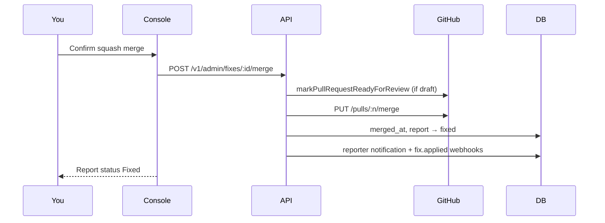

import { Callout } from 'nextra/components'

<AdminDocHero page="fixes" />

# Fixes

**Route:** `/fixes` (sidebar: **Fixes**)

The Fixes page shows every draft pull request Mushi Mushi opened from a real bug,
from the moment a fix run starts to when a PR is ready to review (or the run fails).
Multi-repo coordination rows appear when one report spans several repos.

---

## The fixes list

Tiles above the list count **Attempts (30d)**, **Reports fixed**, **In flight**,
**PRs open** and, when any exist, **Spec warnings** and why auto-fix stopped.

The table has these columns (Pipeline and CI / Agent are hidden in the compact
layout):

| Column | What it is |
| ------ | ---------- |
| **Status** | Where the attempt is, for example queued, running, completed or failed |
| **Report** | The bug the fix is for |
| **Pipeline** | The fix's stages, from dispatch to PR |
| **CI / Agent** | The PR's CI result and the agent that wrote it (a ◆ chip on Cursor Cloud rows links to the run in Cursor) |
| **Started** | When the run started |

Click a row to expand it: branch, token use, CI sync, the PDCA timeline, the
agent's rationale, the files changed, spec-validation warnings and, for Cursor
Cloud runs, the artifact gallery. The Opus review shows in the merge dialog. Coordination rows expand to the
per-repo child attempts grouped underneath.

---

## Live status

While a dispatch runs, the console follows it over a server-sent event stream
(`GET /v1/admin/fixes/dispatch/:id/stream`) and falls back to polling if the stream
drops. The stream carries run status events (started, status, completed, failed) in
the AG-UI envelope format. The server JSON-encodes every payload
([CVE-2026-29085](https://nvd.nist.gov/vuln/detail/CVE-2026-29085)) so an untrusted
string can't inject extra event frames.

---

## Spec-validation warnings

When the fix-worker runs `validateAgainstSpec()` before opening a PR and finds
soft issues — e.g. the diff doesn't touch any file that references the contract's
required DB table — the warnings land in `fix_attempts.spec_validation_warnings`
and appear under **Spec validation warnings** when you expand the fix row, and in
the **Spec warnings** tile above the list.

Hard errors (removing a json_path field the contract asserts on) abort the run
before the PR opens.

---

## Cursor Cloud Agent runs

When `agent = cursor_cloud`, the fix row shows two additional UI elements:

- **Cursor badge**: a ◆ `bc-…` chip that links to the agent run in Cursor's web interface.
- **Artifact gallery**: screenshots, videos and log files the agent produced during the run, fetched after the run ends.

The artifact gallery is visible in the expanded fix detail when artifacts are present.

### Notes-only pull requests

A cloud agent (Cursor or the GitHub Copilot agent) that cannot find the cause
is told to finish without a pull request. If it opens one anyway, Mushi reads
the PR's changed files before trusting it. A PR whose changes are only notes
is not a fix. Notes are a `NEEDS_INVESTIGATION` file, a new markdown file, or
TODO comments. Editing an existing doc page counts as a real change, and so
does any `.txt` file such as `requirements.txt`.

The GitHub Copilot agent opens its draft PR before it pushes anything. So
while an agent is still working, a PR with no files or only notes is attached
to the fix but not judged yet. The report does not move and nobody is
notified. The PR is judged on the files the agent left once the agent
finishes. An empty PR from a finished agent also needs investigation.

When the PR is not a fix:

- the fix row is marked **needs investigation** (`failure_category:
  validation_rejected`) and keeps the PR link so you can read the notes and
  close the PR;
- the report keeps its status instead of moving to **Fixing**;
- your team gets the usual "fix failed" notification.

Mushi reads the files with the project's GitHub token. If it cannot read them
while the agent is still working (GitHub errors, rate limits, a missing
token), the PR waits like an empty one and is read again when the agent
finishes. If the files still cannot be read after the agent has finished, the
PR is trusted and the fix timeline says the contents were not checked.

## Dispatching a fix

You can dispatch a fix from three places:

1. **Report detail** → "Dispatch fix" button (single-repo or auto multi-repo).
   A report with no stack trace, source file or failed request (most web
   vitals and native crashes) leads with "Not a code bug" instead, and the
   button reads "Dispatch anyway": a fix agent usually has nothing to change.
2. **Bugs list** → the **Dispatch fix →** button on a row, which first shows a
   preflight of what is needed.
3. **MCP / A2A / CLI**: `dispatch_fix` tool (`agent=cursor_cloud`), `POST /v1/a2a/tasks`, or `mushi fix <reportId> --agent cursor_cloud`.

All paths produce the same `fix_dispatch_jobs` row and emit the same
`fix.dispatched` webhook to subscribed plugins.

When a project has more than one linked repo, pick the repo the PR opens
against: the **Repo** select beside "Dispatch fix" (it starts on the primary
repo), `targetRepoId` on `dispatch_fix` and `POST /v1/admin/fixes/dispatch`, or
`mushi fix <reportId> --repo <repoId|owner/name>`. Without it, the fix goes to
the primary repo; another project's repo id is refused with
`400 TARGET_REPO_NOT_IN_PROJECT`.

---

## Webhooks

| Event | When |
| ----- | ---- |
| `fix.requested` | Immediately after a fix dispatch is requested (pre-agent launch) |
| `fix.dispatched` | Immediately after the dispatch row is created and agent has started |
| `fix.proposed` | Orchestrator opens a draft PR (Cursor or standard agent) |
| `fix.applied` | Fix completed and PR is merged |
| `fix.failed` | Orchestrator exhausted retries |

Configure webhook endpoints by installing a webhook plugin on
[Plugins](/admin/marketplace) (`/marketplace`). Each delivery is logged with its
status, latency and the start of the response.

---

## CI feedback on open PRs

When a fix-worker or Cursor agent opens a draft PR, GitHub Actions runs on the branch.
The fix detail card shows a **CI badge** with the latest check-run conclusion
(`success`, `failure`, `pending`, etc.).

| Control | What it does |
| ------- | ------------ |
| **Refresh CI status** | Calls `POST /v1/admin/fixes/:id/refresh-ci` → `ci-sync` edge function. Use when webhooks dropped or the badge is stale. |
| **View GitHub Actions log →** | Deep link to the check run on GitHub. |

A background `mushi-ci-sync-10m` pg_cron also refreshes completed attempts every
10 minutes, but on-demand refresh closes the loop immediately after you push a fix
to the PR branch.

From the CLI:

```bash
mushi fixes refresh-ci <fixId>
```

---

## Merging from the console

After CI passes (or you've reviewed manually), merge the draft PR without leaving
Mushi Mushi. This is **user-confirmed**: Mushi merges only what you merge or queue,
or what passes [verified merge](/admin/verified-merge) when you turned it on.

### Where merge appears

- **Report detail** → fix card → **Merge PR** (confirm popover)
- **Fixes list** → completed row with open PR. The **Opus: merge** filter
  (`/fixes?status=review_merge`) lists only the open PRs whose latest Opus
  review said merge; select them and use the bulk **Merge** action
  (see [Merge when ready](#merge-when-ready)).
- **Pipeline flow** on the report detail page

The UI picks the **primary fix attempt** — if a later retry failed but an earlier
attempt still has an open PR, the merge button targets the mergeable attempt, not
the failed retry.

### Merge flow



**Draft PRs:** fix-worker opens PRs as drafts. The PR is marked ready (GitHub's
GraphQL `markPullRequestReadyForReview`, the same as `gh pr ready`) only when the
Opus review says merge on its head, so your CI runs only on an approved commit. A
console merge of a PR that is still a draft marks it ready first.

**Review gate:** while the PR's latest Opus review says **hold**, the merge is
refused unless a team member (not a viewer) overrides it in the console with a
reason. API keys (CLI, MCP) cannot override.

**Merge methods:** squash (default), merge commit, or rebase — chosen in the confirm
popover.

**Already merged:** if GitHub shows merged but the webhook was missed, merge is
idempotent — `finalizeFixMerge()` backfills `merged_at` and report status.

From the CLI (requires `mcp:write` API key):

```bash
mushi fixes merge <fixId>
mushi fixes merge <fixId> --method squash
```

### Merge when ready

The bulk **Merge** action queues the selected PRs by default (ADR 0041). Most
repos require a branch to be up to date before it merges, so merging one PR
leaves the others in that repo behind; the queue does the clicks for you:

1. One PR per repo at a time. A branch that is behind gets GitHub's
   **Update branch**; then the queue waits for CI on the new commit.
2. It merges only when the Opus review of that exact commit says **merge**
   (the update is a new commit, so Opus reviews it again first) and CI is
   green. A hold or fix-first stops the PR until you decide.
3. A merge conflict goes to a Cursor agent on the PR's branch, with your
   review follow-up key and model, only while
   [review follow-ups](/concepts/agent-pr-review#when-the-review-says-fix-first) are on, at most twice per PR.
4. Each merge marks the report Fixed and tells the reporter, as a console
   merge does.

The **Merge when ready** panel on `/fixes` shows each queued PR, what it is
waiting for, and why one is held (red CI, an Opus "fix first" or "hold", no review). **Remove** takes a PR out. You can leave
the page; the queue runs every 5 minutes.

#### Release trains

By default (ADR 0044) approved PRs do not merge one by one. Each merge to
your main branch is a deploy and, for a mobile app, an OTA update, so the
queue batches them into a **release train**:

1. Once every 6 hours, or as soon as 15 PRs are approved, Mushi merges a
   repo's approved PRs into one `mushi/train/…` branch and opens one train
   PR that lists them. A PR that conflicts waits for the next train.
2. CI runs once, on the train. When it is green, Mushi checks each PR's
   Opus review again and merges the train PR with a merge commit. GitHub
   marks every PR in it merged, and each report is marked Fixed.
3. When the train's CI fails, Mushi retries its first half and holds back
   the rest, until it finds the PR that breaks CI. That PR is held, with the
   failing checks named.
4. Fixes for known vulnerabilities and critical bugs skip the wait and merge
   on their own.

In the **Merge when ready** panel, **Release** switches between **Batch**
(trains) and **Each PR**, and the menu sets how often a train leaves. Each
repo shows its train on the way, or when the next one leaves.

If your repo requires a linear history (or has merge commits turned off),
Mushi squash-merges the train instead, then closes each PR in it as shipped
and marks its report Fixed.

**Merge now** (in the same dialog) tries each PR once. The PRs that did not
merge stay listed above the table with GitHub's reason and a
**Merge them when ready** button.

### Prerequisites

| Requirement | Why |
| ----------- | --- |
| Fix status `completed` | Agent finished and opened a PR |
| Open PR (`pr_url`, `pr_number`) | Nothing to merge otherwise |
| GitHub connected | App installation or PAT with merge permission |
| CI green (recommended) | Merge popover warns on failing checks; you can override |

---

## See also

- [Verified merge](/admin/verified-merge): the gates an agent's PR passes before Mushi merges it on its own.
- [Concepts → Fix drafts & PRs](/concepts/fix-orchestrator): how auto-fix works internally.
- [Concepts → Multi-repo coordinated fixes](/concepts/multi-repo-fixes): coordinated multi-repo runs.
- [Connecting your orchestrator](/concepts/orchestrator-interop): dispatch via MCP, A2A, or REST.
