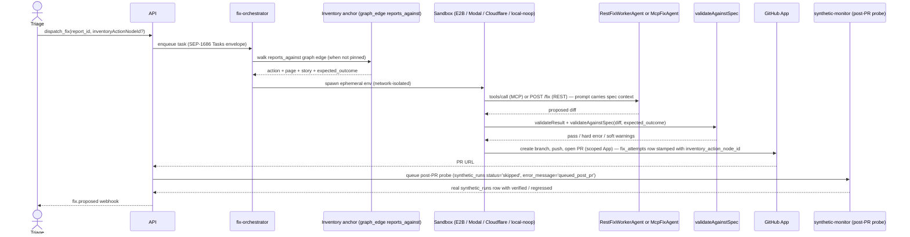

# Fix drafts & PRs

When you click **Dispatch fix** in the admin console, Mushi Mushi has a coding
agent (Mushi's own fix-worker, Cursor, or GitHub's agent) open a draft pull
request on your repo, with a rationale and CI status you can review before
merge.

## Flow



## Sandbox providers

| Adapter        | When to use                              |
| -------------- | ---------------------------------------- |
| `local-noop`   | Tests + local dev (no network at all)    |
| `e2b`          | Default for cloud (managed Firecracker)  |
| `modal`        | Heavy compute / long-running fixes       |
| `cloudflare`   | Edge-routed, sub-second cold starts      |

The adapter abstraction means swapping providers is a config change, not a
code change. Every sandbox run writes a `fix_sandbox_runs` row (provider,
image, CPU, memory, timeout, network deny-by-default and allowed hosts, status)
and its `sandbox_events`, so the isolation settings of each run can be checked
afterwards.

## Agent contract

We support three agent shapes:

- **`McpFixAgent`** — speaks JSON-RPC 2.0 with `tools/call`, plus the
  SEP-1686 Tasks envelope so long-running fixes can stream progress.
- **`RestFixWorkerAgent`** — a simpler REST contract (`POST /fix`,
  `GET /status`) for teams that haven't adopted MCP yet.
- **`CursorCloudAgent`** (new in May 2026) — delegates to a [Cursor Cloud Agent](https://cursor.com/docs/cloud-agent)
  via `@cursor/sdk` in the Node orchestrator. The agent runs in Cursor's managed cloud
  environment, opens a draft PR via `autoCreatePR: true`, and returns the PR URL and agent
  artifacts. It does **not** use an E2B/Modal sandbox; Cursor provides its own runtime. On
  Mushi Cloud the `fix-worker` edge function dispatches Cursor and GitHub cloud agents
  directly through their APIs (`_shared/agent-adapters.ts`).

`McpFixAgent` calls one MCP tool on your agent server (`mushi.generate_fix` by
default, configurable) and `RestFixWorkerAgent` calls your REST endpoint; what
tools the agent uses inside is up to that agent. When a sandbox provider is
configured, filesystem and network access go through the sandbox's policy.

`CursorCloudAgent` receives the fix prompt (including spec context) and uses Cursor's
own tool suite inside the managed cloud environment.

## Credential scoping

The Mushi GitHub App only reaches the repositories you install it on. For each
GitHub call Mushi mints a short-lived installation token (GitHub expires it
after an hour); without the App it uses a token you stored for the project or
organization. The token is not narrowed to one repository or revoked when the
PR opens.

The PR stays a **draft**. `agent-pr-review` reviews it with Claude Opus on your
own Anthropic key and marks it ready (so your CI runs) when the verdict is merge
on that exact commit. When no review is possible (no Anthropic key, or the
review is turned off), a draft Mushi's own fix-worker opened falls back to its
model's own self-check instead. See [Agent PR review](/concepts/agent-pr-review).

## Spec traceability — `inventoryAction` end-to-end

Every fix carries the originating inventory `Action` from dispatch all
the way back to the admin UI. The 2026-05-09 release closed the
write-side U-turn that was the v2 system's biggest open issue.

### What the worker now does

1. **Recover the anchor.** The worker reads `inventory_action_node_id`
   from the dispatch row. If empty (legacy report or the caller didn't
   specify), it walks the `reports_against` graph edge that
   `classify-report` writes when it can match a report to an Action —
   then back-fills the dispatch row so the next consumer doesn't have
   to repeat the walk.
2. **Thread `expected_outcome` into the LLM prompt.** A Markdown block
   rendered by `renderSpecContext()` lists the action description,
   page, story, and every assertion in the contract. The reviewer
   prompt's question 4 explicitly asks the agent to preserve every
   assertion — drift is treated as a regression, not a stylistic note.
3. **Run `validateAgainstSpec` as a deterministic pre-PR gate.**
   Hard-fails the dispatch if the diff *removes* a `json_path` field
   the contract asserts on; soft warnings (no changed file references
   the contract's required DB table, no changed file mentions the
   action's page route) are persisted to
   `fix_attempts.spec_validation_warnings JSONB` so the admin Fixes
   drawer can show "this fix didn't reference the inventory's required
   `users` table — sanity-check before merging".
4. **Queue a targeted post-PR synthetic probe.** A marker `synthetic_runs`
   row scoped to `actionNodeId` is inserted the moment the PR opens.
   The synthetic-monitor cron drains the queue with priority on its
   next tick, runs an HTTP probe, and evaluates `expected_outcome`
   (`status_in` checks + JSONPath assertions) against the live action.
   The result is a real `synthetic_runs` row that flips the Action to
   `verified` or `regressed` in the admin UI within minutes of merge.

### `expected_outcome` shape

```yaml
expected_outcome:
  summary: 'POST /signup returns 200 and creates a user row'
  response:
    status_in: [200, 201]
    json_path:
      - { path: '$.user.id', op: 'exists' }
      - { path: '$.error', op: 'not_equals', value: 'rate_limited' }
  database:
    table: 'users'
    schema: 'public'
    expect: 'row_exists'
  ui:
    route_change_to: '/dashboard'
    visible_text: 'Welcome'
```

Every field is optional except `database.table` (when `database` is set). The
synthetic monitor evaluates the HTTP-side assertions today; database +
UI assertions are recorded as `unverified` until the Playwright crawler
runtime lands. See
[`/v1/schemas/expected-outcome.json`](/concepts/orchestrator-interop#json-schemas)
for the canonical JSON Schema.

### Carrying the anchor through external surfaces

| Surface | How the anchor flows |
| ------- | -------------------- |
| REST `POST /v1/admin/fixes/dispatch` | Optional `inventoryActionNodeId` field on the request body (UUID-validated) |
| MCP `dispatch_fix` tool | `inputSchema.properties.inventoryActionNodeId`; `get_fix_context` returns the full `inventory_action` (with `expected_outcome`) |
| A2A `POST /v1/a2a/tasks` | `input.inventoryActionNodeId` at create time; surfaced on every `GET /v1/a2a/tasks/:id` as `metadata.inventoryActionNodeId` |
| GitHub Action | `inventory-action-node-id` input on `command: dispatch-fix` |
