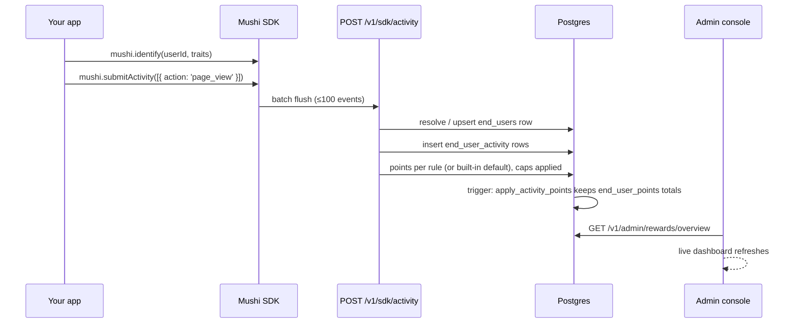

# Tester rewards

Source: https://kensaur.us/mushi-mushi/docs/admin/rewards

---
title: Tester rewards
description: Set up Mushi Mushi tester rewards from the console, with points for reporter activity, a tier ladder, and the perks your app grants at each tier.
---

# Tester rewards

**Route:** `/rewards` (sidebar: **Account → Tester rewards**)

Tester rewards in Mushi Mushi give the people who report bugs a reason to come back.
Activity your users send through the SDK earns points when a rule (or a built-in
default) covers that action. Points advance tiers. Tiers open perks you configure,
such as a role or a coupon your app grants, and (optionally) monetary payouts via
Stripe Connect.

The page has these tabs: **Overview**, **Bounties**, **Activity rules**, **Tier ladder**,
**Contributors**, **Quests**, **Retention**, **Simulator** and **Settings**. **Bounties**
publishes the app to the Mushi Bounties marketplace so outside testers can find bugs for
a reward; this page does not cover it in detail.

  Configuring rules, tiers and webhooks needs **Builder**, **Studio** or **Enterprise**.
  On Free the page shows a preview with an upgrade link. Monetary payouts need
  **Enterprise**.

---

## How the pipeline works



The `identify()` call is the gate. Until a user ID is known, activity events
are buffered and tagged with the anonymous `reporter_token_hash`. As soon as
`identify()` fires (typically on auth state change), the SDK flushes the buffer
with the resolved user traits attached, and the server upserts an `end_users`
record that links all future activity and reports to that identity.

---

## Overview tab

The snapshot strip above the tabs shows **Testers (30 days)**, **Points (30 days)** and
**Payouts waiting**. The Overview tab adds:

| Section | What it shows |
|---------|---------------|
| **Top testers** and **Running quests** | Who leads, and which quests are live |
| **Tier distribution** | How many contributors sit at each tier |
| **Activity feed (last 24 h)** | The latest activity events the SDK sent |

---

## One-click recommended defaults

On an empty Activity rules tab, click **Use recommended defaults** (or call
`POST /v1/admin/rewards/presets/apply`). That idempotently installs:

| Action | Points | Max / day | When it fires |
|--------|-------:|----------:|---------------|
| `report.submitted` | 10 | 20 | After ingest links the report to an `end_user` |
| `report.triaged` | 50 | none | After `classify-report` finishes (awarded once per report) |
| `comment_posted` | 8 | 30 | Reporter comments |

Plus a 4-tier ladder: Explorer (0), Contributor (100), Champion (500) and Legend (2,000). Safe to
re-run — existing custom rules/slugs are never clobbered. Full operator guide:
[`docs/REWARDS.md`](https://github.com/kensaurus/mushi-mushi/blob/master/docs/REWARDS.md).

---

## Activity rules tab

Rules define which user actions earn points and what the caps are. The **Point rules**
table has these columns; edit them in place and click **Save rules**.

| Column | Description |
|--------|-------------|
| **Action** | The `action` string the SDK sends (e.g. `report_submit`) |
| **Base pts** | Points awarded per occurrence. Negative values deduct points. |
| **Daily cap** | Cap per user per day. Empty = unlimited. |
| **Lifetime cap** | Lifetime cap per user. Empty = unlimited. |
| **Enabled** | Toggle without deleting. Disabled rules skip evaluation silently. |

Each rule also carries `multiplier_eligible` and `requires_jwt_verification` flags,
set through the API (`PUT /v1/admin/rewards/rules`), not in the table.

**Built-in fallbacks.** When no rule exists for an action, the server uses a built-in
table, for example `report.submitted` 10, `report.triaged` 50, `report_submit` 10,
`report_confirmed` 50, `report_fixed` 25, `comment_posted` 8 and `report_dismissed` -5.
An action with neither a rule nor a fallback earns nothing.

The server computes each award (rule, caps, tier multiplier), then a PostgreSQL trigger
(`private.apply_activity_points`) keeps the `end_user_points` totals in step.

### Custom rules

The table has no add button. To reward an action you define in your own code, send it
from the SDK:

```typescript
mushi.submitActivity([
  { action: 'lesson_complete', metadata: { lessonId: 'l_123', score: 0.9 } }
])
```

Then upsert a rule with `action: 'lesson_complete'` through `PUT /v1/admin/rewards/rules`.
It starts accruing on the next event; no SDK update is required.

---

## Tier ladder tab

Tiers map a point threshold to a named rank with optional perks. Each tier card lets you
edit:

| Field | Description |
|-------|-------------|
| **Points threshold** | Minimum `total_points` to reach this tier |
| **Display name** | User-visible name (e.g. "Explorer", "Contributor") |
| **Monetary reward (USD)** | Payout queued when a user reaches the tier (monetary plans only) |
| **Enabled** | Turn a tier off without deleting it |

A tier also has a slug, perks JSON and a host credit payload (what your app grants);
the recommended defaults fill these in.

**Default ladder when you have configured no tiers** (shown as "Using default tiers"):

| Tier | Threshold | Color |
|------|----------:|-------|
| Free | 0 | Grey |
| Explorer | 100 | Blue |
| Contributor | 500 | Purple |
| Champion | 2 000 | Amber |

Edit the ladder to match your own program. Tier evaluation runs inside
`awardPointsForEndUser` after every award; if the new total crosses a threshold, a
`reward.tier_changed` webhook fires.

---

## Contributors tab

A leaderboard of your top reporters, ranked by points. Choose the last 30 days or
all time, filter by tier, and search by name.

**Per-contributor drill-down** (`/v1/admin/rewards/contributors/:id`) shows:

- **Lifetime points** and **Activity events**
- Each `end_user_activity` entry with the action, points awarded, and timestamp
- **Anti-fraud flags**, when there are any
- **Admin actions**: **Award bonus points** and **Override tier**

Export and erasure are SDK routes the end user calls (see [GDPR & consent](#gdpr--consent)),
not console buttons.

  The Contributors tab shows email addresses and display names collected via
  `identify()` traits. Make sure your privacy policy discloses that you collect
  this data through the Mushi SDK before enabling rewards. See the
  [Privacy & GDPR](#gdpr--consent) section below.

---

## Quests tab

Quests are multi-step goals. A user completes a quest by performing a defined
sequence of actions.

**Example quest**, "First Feedback" (each step is one action with a label):
1. `screen_view_unique_per_day`, label "Look around the app"
2. `report_submit`, label "Send your first bug report"
3. `comment_posted`, label "Reply to the team"

Completing a quest awards bonus points in addition to the per-action awards, and
fires a `reward.quest_completed` webhook.

### Quest editor

Click **New quest** to open the editor:

- **Quest name** and **Description (optional)**
- **Bonus points on completion**
- **Expires after (days, optional)**
- **Steps (in order)**: each step has an action and a label (for example "Visit /pricing")
- **Repeatable**: whether a user can complete the same quest more than once

Quest progress is evaluated server-side in `evaluateQuestProgress` after each
activity flush, so no client-side code is needed to track completion state.

---

## Retention tab

The Retention tab (**Retention impact**) compares how long contributors in your highest
tier keep coming back with everyone else: the top tier's median retention in days,
the others' median, and the **Retention lift** between them. It is computed on request
by `GET /v1/admin/rewards/retention-impact`.

---

## Simulator tab

The **Sandbox simulator** previews how an activity log would score against your
current rules, without real data.

1. Type an `action` name and a count for each line; **+ Add event** adds a line.
2. Click **Run simulation**. The server applies your rules and caps and returns
   **Total points**, the **Reached tier**, and a breakdown per action
   (count, points per event, subtotal, note).

Nothing is written: no `end_users` row is created or changed.

Use this to sanity-check daily cap edge cases before you change a rule.

---

## Settings tab

The Settings tab has four sections: **Host webhooks**, **Identity verification**
(JWKS URL, audience and issuer for verifying your users' tokens), **Payout ledger** and
**Disputes**.

Consent and widget display are SDK options, not console settings: `consentMode`
(`explicit`, the default, or `auto`), `showInWidget` and `showNotifications` in the
SDK's rewards config.

### Webhooks

Webhook payloads are sent for these events. Every payload carries `event`,
`end_user_id` and `occurred_at`:

| Event |
|-------|
| `reward.points_awarded` |
| `reward.tier_changed` |
| `reward.quest_completed` |
| `reward.payout_requested` |
| `reward.payout_paid` |

Add endpoints under **Host webhooks** (an HTTPS URL and an optional signing secret of at
least 16 characters; leave it empty and Mushi Mushi creates one and shows it once), and
send a test event from there. `@mushi-mushi/node` exports `createMushiRewardsHandler` to
verify and route these events in your server.

---

## Monetary payouts (P2)

  Monetary payouts require the **Enterprise** plan and a connected Stripe
  account. Each end user onboards through the SDK route `POST /v1/sdk/me/payout/onboard`.

When monetary payouts are enabled:

1. Each contributing user completes a Stripe Connect Express onboarding.
2. A payout is queued when a user reaches a tier that has a **Monetary reward (USD)**.
3. The `reward-payout-aggregator` cron job (monthly, on the 1st at 09:00 UTC) checks
   the user's KYC and anti-fraud flags, then sends the Stripe transfer and marks the
   `reward_payouts` row paid or failed.
4. **Payout ledger** in the Settings tab lists the payouts, so you can top up your
   Stripe balance before the run.

The JWT verification step (`verifyUserToken` in `MushiRewardsConfig`) ensures
that monetary awards are only issued to authenticated users whose identity the
host app can vouch for — preventing anonymous abuse.

---

## GDPR & consent

The rewards pipeline stores:

| Table | Data |
|-------|------|
| `end_users` | `external_user_id`, optional `email` + `display_name`, `last_seen_at` |
| `end_user_activity` | `action`, `points_awarded`, `occurred_at`, metadata |
| `end_user_points` | `total_points`, `points_30d`, `points_lifetime` |

**User rights** are handled by SDK endpoints:

| Endpoint | Right |
|----------|-------|
| `GET /v1/sdk/me/export` | Data portability — returns the full activity log as JSON |
| `DELETE /v1/sdk/me` | Erasure — deletes the end user's activity, sessions and analytics events, zeroes `end_user_points`, anonymises the `end_users` row |
| `POST /v1/sdk/me/consent` | Withdraw / re-grant opt-in; withdrawal stops new award events |

  **These three routes need proof of who is asking.** Since 2026-09-22 each
  one requires either your host JWT (`verifyUserToken`, the same signing key
  the rewards pipeline uses) or a signed `X-Mushi-User-Token` for that end
  user; without one the route answers `IDENTITY_PROOF_REQUIRED`, and a token
  for somebody else answers `IDENTITY_SUBJECT_MISMATCH`. Before that, an
  `identify()` id alone was enough — and those ids are usually guessable, so
  one person could export or erase another person's data. Wire
  `verifyUserToken` (see [Monetary payouts](#monetary-payouts-p2)) before you
  point users at a privacy screen.

If you use `consentMode: 'explicit'` (the default), the SDK surfaces a
one-time prompt before the first `identify()` flush. The user's choice is
persisted server-side in `end_users.opted_in`, so it follows them across
devices.
