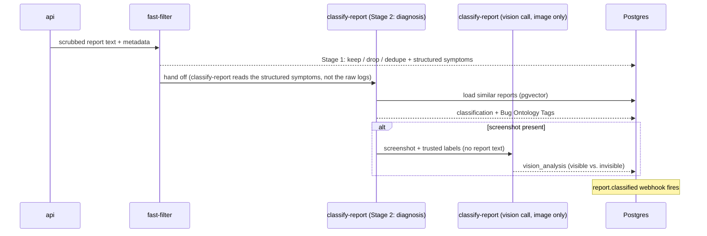

# How Mushi Mushi reads a bug report

Source: https://kensaur.us/mushi-mushi/docs/concepts/classification

---
title: How Mushi Mushi reads a bug report
description: How Mushi Mushi turns a raw bug report and screenshot into a plain-English diagnosis. The fast filter, the diagnosis and vision steps, and what gets stored.
---

# How Mushi Mushi reads a bug report

When a user submits a report, Mushi Mushi turns raw text and screenshots into a
plain-English summary — severity, category, and what to try next — before
anything hits your editor.

## Outputs

- `category` (`bug`, `slow`, `visual`, `confusing`, `other`)
- `severity` (`low` / `medium` / `high` / `critical`). The nightly judge scores
  severity calibration and feeds the prompt-A/B framework.
- `component` (resolved against your project's component taxonomy if uploaded).
- `bug_ontology_tags` (tags from the shared bug ontology).
- `confidence` ∈ [0, 1].
- `summary` (one-sentence triage headline).

## Vision air-gap

The screenshot is read in a **separate, image-only call** with its own fixed
system prompt and no report text, after the diagnosis is finished. This limits
[OWASP LLM01](https://owasp.org/www-project-top-10-for-large-language-model-applications/)
prompt injection via images: a screenshot containing "ignore prior
instructions" cannot change the diagnosis, which is already written. The call
records any text in the image as data and flags injection attempts. See
[Prompt-injection defence](/security/prompt-injection).

## BYOK

Per-project keys (Anthropic and/or OpenAI) override the cluster default.
Failover order:

1. Project's BYOK Anthropic key (if set)
2. Cluster Anthropic env var (if set)
3. Project's BYOK OpenAI key
4. Cluster OpenAI env var

Every invocation logs which key source was used so finance can attribute
spend without inspecting the prompt.
