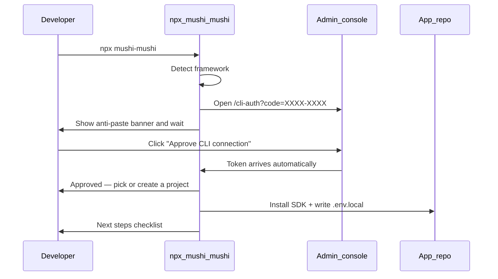
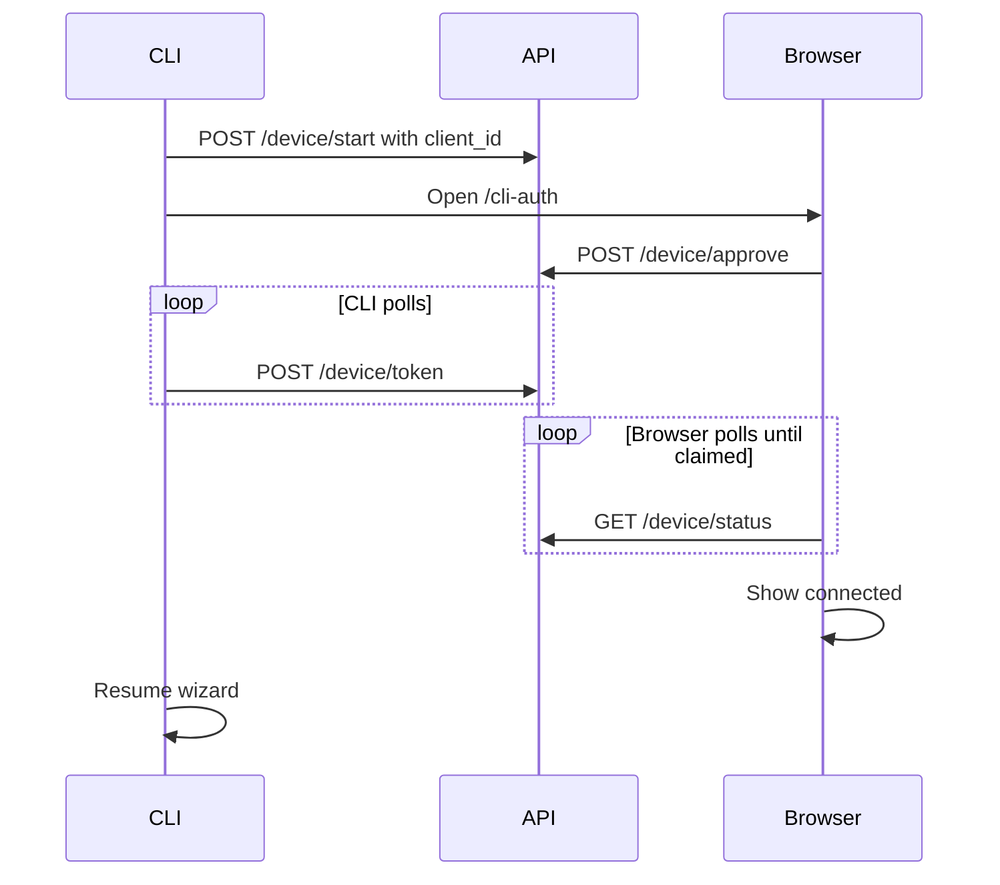

# CLI ↔ console setup loop

Source: https://kensaur.us/mushi-mushi/docs/quickstart/cli-console-loop

---
title: CLI ↔ console setup loop
description: How npx mushi-mushi creates a Mushi Mushi project, mints an SDK key and installs the SDK through browser sign-in, and how to recover when the setup loop fails.
---

# CLI ↔ console setup loop

- `npx mushi-mushi` does the whole setup: sign-in, project, API key and SDK install.
- You never paste a key. You click **Approve** in the browser and the terminal carries on.
- Something stuck? See [Troubleshooting](#troubleshooting) and the manual fallback below.

## Set up in five steps

### 1. Run the wizard

```bash
npx mushi-mushi
```

The wizard auto-detects your framework (Next.js, React, Vue, Expo, …).

**You'll see:** a box with a verification code, and a browser tab opening.

### 2. Approve in the browser

A browser tab opens at `/cli-auth?code=XXXX-XXXX`. Click **Approve CLI connection**.
The browser waits until your terminal claims the token, then shows connected.
Nothing to copy or paste.

**You'll see:** "CLI connected!" and "Switch back to your terminal now" in the browser.

### 3. Pick or create a project

The wizard lists your existing projects. Choose one or enter a name to create a
new project. The SDK API key is minted automatically.

### 4. SDK installed

The wizard installs the SDK package and writes the project ID and the SDK key
to `.env.local` (or `.env` if that is the file you have), named with your
framework's prefix: for example `VITE_MUSHI_PROJECT_ID` and
`VITE_MUSHI_API_KEY`, `NEXT_PUBLIC_MUSHI_…` on Next.js, `EXPO_PUBLIC_MUSHI_…`
on Expo. It adds `MUSHI_API_ENDPOINT` only when you point it at a self-hosted
server.

**You'll see:** a next-steps checklist in the terminal, and the Mushi settings in `.env.local`.

### 5. Wire Cursor MCP (optional but recommended)

At the end the wizard asks whether to run `mushi connect --write-env
--wire-ide --wait` now. Say yes. It writes `.cursor/mcp.json` and waits for the
first SDK heartbeat to confirm the connection is live.

To run it later by hand, pass the key, project ID and endpoint yourself
(`mushi connect` does not read them from the saved login):

```bash
MUSHI_API_KEY=mushi_xxx npx mushi-mushi connect \
  --project-id <uuid> \
  --endpoint https://dxptnwrhwsqckaftyymj.supabase.co/functions/v1/api \
  --wait
```

**You'll see:** the first heartbeat confirmed in the terminal once your app runs with the SDK.

The rest of this page explains each command, how sign-in works, and how to
recover when it fails.

## Which CLI command?

The bare `mushi …` form needs the CLI installed (`npm i -g @mushi-mushi/cli`).
Without it, run the same command as `npx mushi-mushi …`, for example
`npx mushi-mushi login`.

| Command | When to use | What it does |
| --- | --- | --- |
| **`npx mushi-mushi`** / **`mushi init`** | First SDK install in an app repo | Detects framework, opens browser auth, installs SDK, writes `.env.local` |
| **`mushi login`** | Authenticate the CLI without installing | Browser sign-in only; persists to the [CLI config file](/sdks/cli#config-file) (`~/.config/mushi/config.json`, or `%APPDATA%\mushi\config.json` on Windows) |
| **`mushi connect`** | You already have credentials; want env + MCP + proof | Merges env vars, wires `.cursor/mcp.json`, optional `--wait` heartbeat |
| **`mushi setup`** | MCP-only wiring | Writes Cursor/Claude MCP config (signs you in first if needed); **does not** install the SDK |

  `mushi setup` is for MCP wiring only, not SDK installation. To install
  the SDK for the first time, run `npx mushi-mushi` (not `mushi setup`).

  **SDK ingest keys** (`report:write` scope) come from **Set up → Test it** or
  **Manage apps** in the console. **Settings → AI keys** is for your own
  LLM and Firecrawl keys, not Mushi project credentials.

## Browser sign-in flow (recommended)

`npx mushi-mushi` uses browser sign-in (no paste) via RFC 8628:



### What happens in the terminal

When the wizard starts the browser sign-in step, you will see a box like this:

```
  ┌──────────────────────────────────────────────────────────┐
  │  Browser sign-in — follow these 3 steps                  │
  ├──────────────────────────────────────────────────────────┤
  │                                                          │
  │  1. A browser tab will open (or visit the URL below)    │
  │  2. Sign in if prompted, then click "Approve"           │
  │  3. Come back here — setup continues automatically      │
  │                                                          │
  ├──────────────────────────────────────────────────────────┤
  │  Verification code (show in browser — NOT terminal):    │
  │                                                          │
  │    TGKX-PBXP                                            │
  │                                                          │
  │  ⚠  Do NOT paste or type this code in your terminal     │
  └──────────────────────────────────────────────────────────┘

  If the browser didn't open, visit this URL and approve:
    https://kensaur.us/mushi-mushi/admin/cli-auth?code=TGKX-PBXP

  ⏳ Waiting for browser approval… (Ctrl+C to cancel)
```

**The terminal waits automatically.** You do not need to type or paste anything.
Switch to your browser, approve, then come back to this terminal.

### What happens in the browser

The console shows a 3-step guide and displays the same code:

1. Confirm the code matches what your terminal printed
2. Click **Approve CLI connection**
3. Switch back to your terminal; setup resumes automatically

After you click **Approve**, the browser shows a **waiting** state while the CLI
claims the token. When the terminal picks it up, the page switches to **"CLI
connected!"** with **"Switch back to your terminal now"**, and the terminal
continues to the project picker.

## How sign-in reliability works

Each machine gets a stable `client_id`, stored in the [CLI config file](/sdks/cli#config-file)
(`~/.config/mushi/config.json`, or `%APPDATA%\mushi\config.json` on Windows).
The CLI sends it when starting device auth so concurrent logins on the same
machine behave predictably.



**Concurrent logins:** Starting a new `mushi login` or `npx mushi-mushi` on the
same machine supersedes any older pending approval for that `client_id`. If you
have two terminals waiting, only the newest poll wins. Close the stale one and
run the wizard again.

**Re-running the wizard:** If credentials are already saved, the CLI validates
them with `GET /v1/sync/whoami` before reinstalling anything.

## Console URLs

| Environment | Admin console | Notes |
| --- | --- | --- |
| **Hosted (production)** | [kensaur.us/mushi-mushi/admin](https://kensaur.us/mushi-mushi/admin) | Default for external apps |
| **Local monorepo dev** | [http://localhost:6464](http://localhost:6464) | Run `pnpm dev` from the mushi-mushi repo |
| **Override** | Set `MUSHI_CONSOLE_URL` | CLI hints + browser opens use this base when set |

The CLI resolves the console in this order: `MUSHI_CONSOLE_URL` → `consoleUrl`
saved in the [CLI config file](/sdks/cli#config-file) (`~/.config/mushi/config.json`,
or `%APPDATA%\mushi\config.json` on Windows) → localhost `:6464` probe → hosted default.

## Manual paste (fallback / self-hosted)

If the browser auth path isn't available, select "Paste a Project ID + API key"
in the wizard, or pass flags directly:

```bash
npx mushi-mushi init --project-id <uuid> --api-key mushi_xxx
```

To get the values manually:

| Value | Where to find it |
|---|---|
| `projectId` | The app's UUID on [Manage apps](https://kensaur.us/mushi-mushi/admin/projects), or on the success panel shown after you create a project |
| `apiKey` | [Set up → Test it](https://kensaur.us/mushi-mushi/admin/onboarding?tab=verify) → **Generate API key**, or **Manage apps → Generate API key** with the **SDK ingest** preset (scope: `report:write`) |

  **Settings → AI keys** is for your own LLM and Firecrawl keys, not SDK ingest
  keys. Make `report:write` project keys on **Set up → Test it** or **Manage apps**.

## CI / non-interactive

Pass all three flags so the wizard skips all interactive prompts:

```bash
npx mushi-mushi --yes --project-id <uuid> --api-key mushi_xxx
```

Or use the non-interactive connect command after minting a key in the console:

```bash
MUSHI_API_KEY=mushi_xxx npx mushi-mushi connect \
  --project-id <uuid> \
  --endpoint https://dxptnwrhwsqckaftyymj.supabase.co/functions/v1/api \
  --write-env --wire-ide
```

`connect` writes a key to `.env.local` only when the server confirms it is
ingest-only (`report:write`). A key that can read reports still works for the
CLI and MCP; pass the ingest key separately with `MUSHI_SDK_KEY` or `--sdk-key`.

## Troubleshooting

| Symptom | Cause | Fix |
| --- | --- | --- |
| `command not found: TGKX-PBXP` | You pasted the verification code into the shell | That code belongs in the **browser**, not the terminal. The terminal waits automatically. |
| Terminal exits immediately after showing code | Browser tab didn't open; terminal was closed | Keep the terminal open. Open the URL from the banner manually if the tab didn't open. |
| "Wizard opens wrong console URL" | Hosted default while you meant local dev | Run `pnpm dev`, or set `MUSHI_CONSOLE_URL=http://localhost:6464` |
| "Invalid project ID" | Pasted name instead of UUID | Copy the app's UUID from **Manage apps** |
| 401 / whoami failure | Wrong key or revoked key | Mint a new key on [Set up → Test it](https://kensaur.us/mushi-mushi/admin/onboarding?tab=verify) |
| "Browser sign-in timed out" | 10-minute code expired before approval | Run `npx mushi-mushi` again; a new code is generated |
| `--write-env` unknown or ignored | An older global CLI | Upgrade: `npm i -g @mushi-mushi/cli@latest`, or use `npx mushi-mushi connect` |
| Non-interactive hang in CI | TTY prompts with partial flags | Pass `--yes --project-id  --api-key mushi_xxx` |
| Browser says connected, terminal still waiting | Stale browser tab, wrong terminal window, or superseded poll from a second login | Close old `/cli-auth` tabs. Use the terminal that started the most recent `npx mushi-mushi`. Run the wizard again if needed. |
| Browser stuck on "waiting" after Approve | CLI has not claimed the token yet (slow network) or terminal was closed | Keep the terminal open. After ~45s the browser shows stale-tab help. |
| Terminal still waiting after browser connected | Token poll hit a different `device_code` than the open browser tab | Run `npx mushi-mushi` again in the terminal you want to use. Approve in the fresh browser tab only. |
| `429 Too Many Requests` during token poll | Rate limit on `/device/token` | The CLI retries automatically. Wait a few seconds; do not click Approve again. |
| `408 Request Timeout` during token poll | Transient network blip | The CLI retries automatically. If it persists, check firewall/proxy rules. |

## Related

- [Credentials](/concepts/credentials): scopes, env var names, endpoints
- [Admin → Onboarding](/admin/onboarding): in-console checklist + success panel
- [Connect & Update](/admin/connect): copy commands with your active project prefilled
- [MCP quickstart](/quickstart/mcp): IDE wiring after credentials are saved
- [SDK reliability deploy checklist](https://github.com/kensaurus/mushi-mushi/blob/master/docs/operators/sdk-reliability-overhaul.md): operators self-hosting the stack
