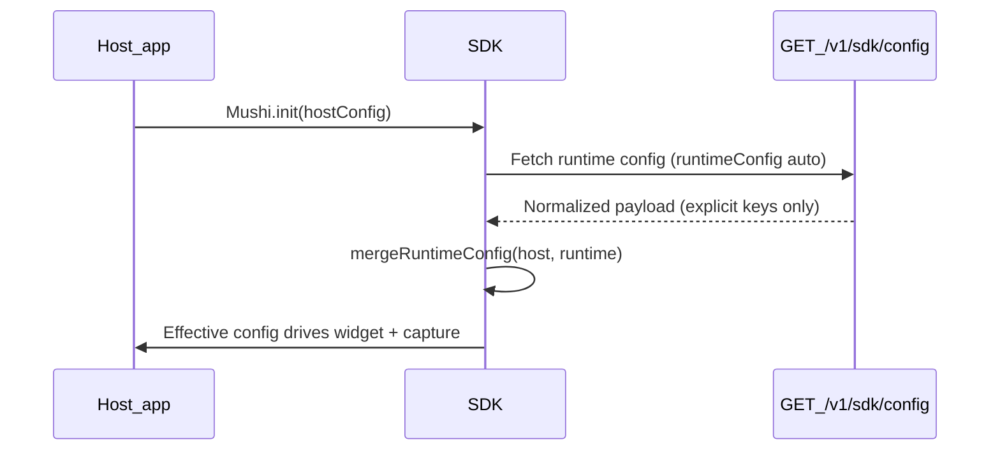

# Mushi SDK Runtime Config Merge

**Shipped in `@mushi-mushi/web` and server edge functions (Jul 2026).**

Before this release, `GET /v1/sdk/config` could emit column defaults for widget
and capture fields. The client merge treated those as explicit overrides — so a
host that wired `widget: { trigger: 'banner' }` could lose its top banner when
the console row still had the default `launcher: 'auto'`. A similar split existed
between the admin and public config normalizers (`reporterNotificationsEnabled`
never reached the live SDK from one code path).

The fix is two-part: **explicit-only emission** on the server and **host-priority
merge** on the client.

## Table of contents

- [Data flow](#data-flow)
- [Server: explicit-only emission](#server-explicit-only-emission)
- [Client: merge precedence](#client-merge-precedence)
- [Capture merge](#capture-merge)
- [Banner and launcher merge](#banner-and-launcher-merge)
- [Widget draft persistence](#widget-draft-persistence)
- [Backend endpoints](#backend-endpoints)
- [File responsibilities](#file-responsibilities)
- [Related docs](#related-docs)

---

## Data flow

| Stage | Input | Output |
| --- | --- | --- |
| Host init | `MushiConfig` in code | Baseline widget, capture, privacy |
| Server normalize | `project_settings` columns | SDK JSON with defaults omitted |
| Client merge | host + runtime | Effective config for widget render |

User-facing summary: [Runtime config concept page](https://kensaur.us/mushi-mushi/docs/concepts/runtime-config).

---

## Server: explicit-only emission

Single normalizer: `packages/server/supabase/functions/_shared/sdk-config.ts`

Consumed by:

- `GET /v1/sdk/config` (`api/routes/public.ts`)
- `GET/PUT /v1/admin/projects/:id/sdk-config` (via re-export in `api/helpers.ts`)

**Rule:** widget and capture keys are included only when the console value differs
from the platform default. A column still at its default means "never configured"
and is omitted so the client cannot clobber host init.

| Column default | Emitted when |
| --- | --- |
| `sdk_widget_launcher = 'auto'` | Only if set to `banner`, `edge-tab`, `manual`, or `hidden` |
| `sdk_capture_screenshot = 'on-report'` | Only if set to `'auto'` or `'off'` |
| `sdk_capture_console = true` | Only if set to `false` |
| `sdk_capture_element_selector = false` | Only if set to `true` |
| `sdk_screenshot_sensitive_hint = NULL` | Only when non-null (`''` → hide caption) |
| `sdk_widget_accent = NULL` (auto: match the site) | Only when set to a `#rrggbb` colour, as `widget.accent` plus `widget.accentText` |

`widget.accentText` is black or white, whichever reads better on the accent; the
server never serves a pair under 3:1 (`accentInk`). The column accepts only one
exact hex colour (check constraint, migration
`20261122120000_sdk_widget_accent.sql`), which is what lets the server promise
that contrast. Until that migration is applied, both config routes re-read
without the column (`isMissingAccentColumn`), so deploying `api` first does not
break any installed widget; saving a colour answers 503 `MIGRATION_PENDING`.

`reporterNotificationsEnabled` and the `assistant` block are always emitted with
resolved booleans so console toggles match live SDK behavior.

---

## Client: merge precedence

Implementation: `packages/web/src/runtime-merge.ts` (`mergeRuntimeConfig`)

### Trigger / launcher

| Host `widget.trigger` | Runtime sends | Effective trigger |
| --- | --- | --- |
| `'banner'` | `launcher: 'auto'` | `'banner'` (runtime `auto` ignored) |
| `'attach'` | any except `hidden` | host attach unchanged |
| `'manual'` | any except `hidden` | `'manual'` (the app draws its own launcher; a console launcher would add a second one) |
| unset | `launcher: 'banner'` | `'banner'` |
| `'hidden'` | runtime not explicitly `hidden` | host non-hidden preserved |

Runtime `launcher: 'auto'` or `widget.trigger: 'auto'` does **not** override a
host non-auto trigger.

### Widget appearance keys: code wins (ADR 0068)

One rule for every widget key except the launcher (below): **an explicit value
set in the host's code wins; the console's runtime value fills only what the
code left unset; then the SDK default.** Decided by the owner on 2026-11-22
([ADR 0068](./adr/0068-host-code-wins-over-console-widget-settings.md)); before
it, the console won for position, theme and trigger text and the host won only
for `brandFooter`.

| Key | Set in code | Console sends | Effective |
| --- | --- | --- | --- |
| `position` | `'top-left'` | `'bottom-left'` | `'top-left'` |
| `position` | unset | `'bottom-left'` | `'bottom-left'` |
| `position` | unset | omitted | `'bottom-right'` (default) |
| `theme` | `'light'` | `'dark'` | `'light'` |
| `theme` | unset | `'inherit'` | `'inherit'` |
| `triggerText` | `'Feedback'` | `'Report a bug'` | `'Feedback'` |
| `accent` (+ `accentText`) | `'#e03c2c'` | `'#3b5bdb'` + `'#ffffff'` | `'#e03c2c'`, the widget computes its text colour |
| `accent` (+ `accentText`) | unset | `'#3b5bdb'` + `'#ffffff'` | `'#3b5bdb'` with `'#ffffff'` text (the pair always travels together) |
| `screenshotSensitiveHint`, `attachToSelector`, `brandFooter`, … | any explicit value | anything | the code's value |
| any of them | unset | omitted | the SDK default |

"Set in code" includes `data-*` attributes on the script tag, which the loader
turns into `Mushi.init` options. It is judged against the *bootstrap* config
(the third argument of `mergeRuntimeConfig(active, runtime, host)`), so a cached
runtime payload applied on an earlier merge never counts as a host value.
To let the console decide a key, remove it from the code.

Runtime values apply only when defined and non-null. `betaMode` from host is
never dropped. Capture flags are not widget appearance keys and keep their own
rule ([Capture merge](#capture-merge)).

### `widget.brandFooter` (the "Bug reports by Mushi" mark)

The same rule as every appearance key: host wins, then runtime, then the default `false`:

| Host `widget.brandFooter` | Runtime sends | Effective |
| --- | --- | --- |
| `true` / `false` (explicit) | anything | host value (MIT config always wins) |
| unset | `true` | `true` — Free Cloud projects by default |
| unset | `false` | `false` — paid plans and self-host |
| unset | omitted | `false` |

`mergeRuntimeConfig(active, runtime, host)` takes the *bootstrap* config as
its third argument so a cached runtime payload can never masquerade as a host
decision on the second merge. The server derives the runtime value from
`project_settings.widget_brand_footer` (tri-state, console → Settings →
General → "Feedback widget") falling back to the plan: `true` for Free Cloud,
`false` otherwise. The rendered mark links to
`https://kensaur.us/mushi-mushi/?utm_source=widget&utm_medium=powered-by&ref=<sha256(projectId)[0:12]>`
and emits `loop_impression` (once per widget session) and `loop_click`
through `Mushi.track()`; both are silent under DNT/GPC, denied consent or
`analytics.enabled: false`.

### Banner copy

The same rule, field by field: each runtime banner field (`bannerMessage`,
`bannerVariant`, `bannerPosition`, `bannerLabel`, `bannerBugCta`,
`bannerFeatureCta`) fills the matching `bannerConfig` field only when the host's
`bannerConfig` left it unset.

---

## Capture merge

`mergeRuntimeCapture(host, runtime)` copies host capture first, then overlays
runtime keys where the value is not `undefined`.

| Host | Runtime | Result |
| --- | --- | --- |
| `elementSelector: true` | omitted (console default) | `true` |
| `screenshot: 'off'` | omitted | `'off'` |
| `console: true` | `console: false` | `false` |
| `network: true` | `network: false` | `false` |

---

## Banner and launcher merge

**Incident:** Host init used `trigger: 'banner'`. Console row untouched
(`launcher` column default `'auto'`). Old normalizer always emitted
`launcher: 'auto'`. Client merge replaced banner with FAB — top strip vanished.

**Fix:** Server omits default launcher; client ignores runtime `auto` when host
trigger is non-auto.

---

## Widget draft persistence

`packages/web/src/widget.ts` captures description, email, and reply field values
(and caret position) before `innerHTML` rebuilds, then restores them after render.

| Event | Draft behavior |
| --- | --- |
| Runtime config refresh | Preserved |
| Route change while panel open | Preserved |
| Successful submit | Description draft cleared |
| New report session | All drafts cleared |

Capture availability: `setCaptureAvailability()` hides screenshot/element buttons
when unavailable; `setElementError()` surfaces inline failure copy.

---

## Backend endpoints

| Method | Path | Auth | Role |
| --- | --- | --- | --- |
| GET | `/v1/sdk/config` | `apiKeyAuth` | Runtime payload for SDK merge |
| GET | `/v1/admin/projects/:id/sdk-config` | `adminOrApiKey(mcp:read)`, any member | Console read (same normalizer) plus `canEdit`; MCP `get_widget_settings`, `mushi widget show` |
| PUT | `/v1/admin/projects/:id/sdk-config` | `adminOrApiKey(mcp:write)`, owners and admins | Validates with `sdkConfigUpdateErrors()` (400 naming the field), 60 saves an hour per app, persists via `coerceSdkConfigUpdate()`, audit row with the actor type; MCP `set_widget_settings`, `mushi widget set` |

---

## File responsibilities

| File | Role |
| --- | --- |
| `_shared/sdk-config.ts` | `normalizeSdkConfig`, `coerceSdkConfigUpdate`, `sdkConfigUpdateErrors`, accent parsing and contrast |
| `_shared/widget-settings.ts` / `packages/mcp/src/widget-settings.ts` | The MCP widget tools' body and view (kept identical) |
| `_shared/sdk-config.test.ts` | Explicit-only emission regressions |
| `packages/web/src/runtime-merge.ts` | Client merge precedence |
| `packages/web/src/runtime-merge.test.ts` | Banner trigger regression; code-wins matrix per key |
| `packages/web/src/mushi.ts` | Fetches config, calls merge, wires capture availability |
| `packages/web/src/widget.ts` | Draft capture/restore, capture UI |
| `api/routes/public.ts` | Public config route (imports shared normalizer) |
| `api/helpers.ts` | Re-exports shared normalizer for admin routes |

---

## Related docs

- [Runtime config (public)](https://kensaur.us/mushi-mushi/docs/concepts/runtime-config)
- [@mushi-mushi/web SDK reference](https://kensaur.us/mushi-mushi/docs/sdks/web)
- [Trigger modes](https://kensaur.us/mushi-mushi/docs/concepts/trigger-modes)
- [SDK screenshot preview](./SDK_SCREENSHOT_PREVIEW.md)
- [SDK assistant](./SDK_ASSISTANT.md)
- [Operator deploy checklist](./operators/sdk-reliability-overhaul.md)
