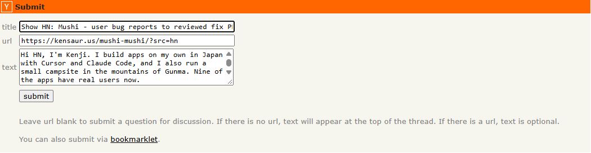
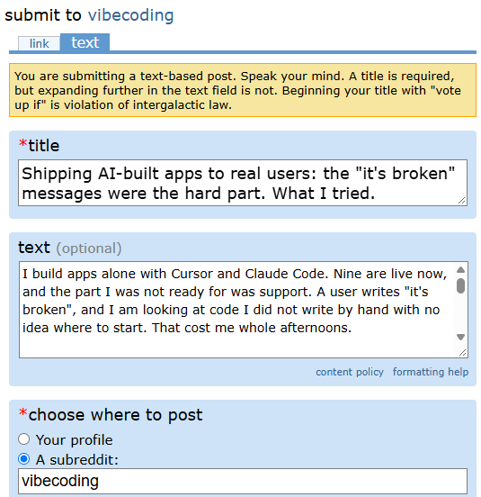
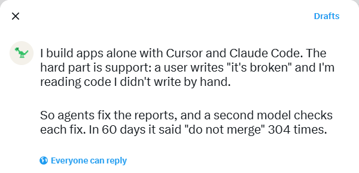
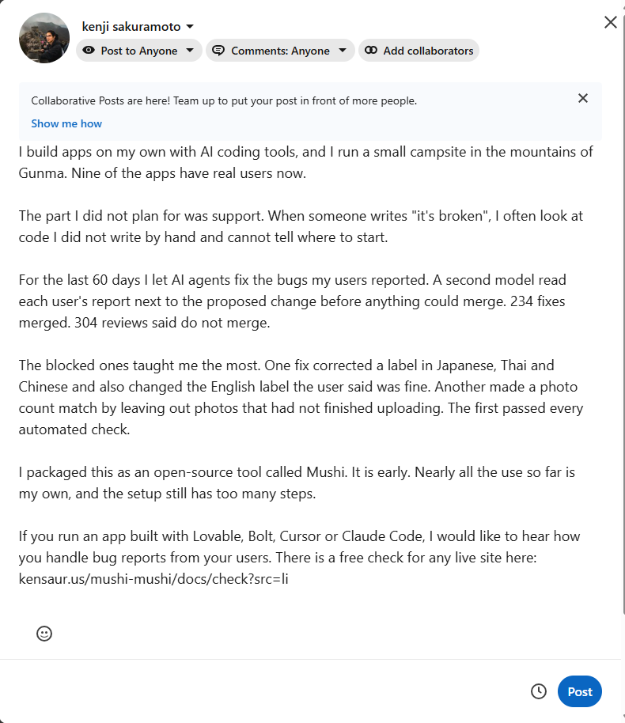

# Launch log: what was posted where

One entry per post. Each entry keeps the exact text, a screenshot of it, and
the live link once it is up. Screenshots are cropped to the post itself (no
feeds, inboxes or subscription lists: this repo is public).

When a post goes live: set **Status** to `posted`, fill **Live URL** and
**Posted at** (JST), and add a screenshot of the live post as
`YYYY-MM-DD-<platform>-live.png`.

Numbers in every post come from the public scoreboard
(`GET /v1/public/scoreboard`, also https://kensaur.us/mushi-mushi/proof),
read 2026-10-29 at 00:02 UTC: 9 apps, 676 user reports from 314
reporters, 234 fixes merged (median 26.4 h), 835 AI reviews, 304 of them
"do not merge". The two blocked-fix stories are real reviews:
the-wanting-mind #222 and help-her-take-photo #163 (`fix_reviews`).

## Tone (2026-10-29)

Problem first, in the owner's voice, with what is still rough. No hard sell.

- Say who you are and the pain: building alone, "it's broken" messages about
  code you did not write by hand.
- Two true stories and the measured numbers, nothing rounded up.
- Name what is still rough: nearly all use is the owner's own apps; a first-time
  visitor test got stuck at the login page; setup has too many steps.
- End on a real question. On Reddit, say you built it and keep the link out of
  the post.
- No em dashes, no "Here's what I learned", no emoji hooks, no reflex lists of
  three, no "not X but Y", no price pitch up front.

Sources: Show HN guidelines (news.ycombinator.com/showhn.html: something people
can try without sign-up, explain how and why you made it, no landing pages);
the AI-tell list in the docs-writer skill (`references/plain-language-ste.md`);
r/SideProject's sidebar (title format "[Project name] - [Short description]").

## 2026-10-29 drafts

| Platform | Account | Status | Live URL | Posted at |
|---|---|---|---|---|
| Hacker News (Show HN) | owner | drafted, not posted | | |
| Reddit r/vibecoding | u/sakuramoto | drafted, not posted | | |
| X | owner | drafted, not posted | | |
| LinkedIn | kenji sakuramoto | drafted, not posted | | |

### Hacker News



- **Title:** Show HN: Mushi - user bug reports to reviewed fix PRs, for AI-built apps
- **URL:** https://kensaur.us/mushi-mushi/?src=hn
- **Text** (HN does not say whether text sent with a URL becomes the first
  comment; if it does not show on the post, paste it as the first comment):

```text
Hi HN, I'm Kenji. I build apps on my own in Japan with Cursor and Claude Code, and I also run a small campsite in the mountains of Gunma. Nine of the apps have real users now.

The problem I kept hitting: someone writes "it's broken", I open code I didn't write by hand, and I can't tell where to start. When I asked an agent to fix it, the fix often looked right and wasn't.

Mushi is what I built to cope with that. A user taps a report button in the app. Mushi attaches the screen, console and network calls, writes a plain-English diagnosis, and an agent opens a pull request. Then a second model reads the original report and the diff and decides whether it may merge.

Over the last 60 days on my own apps: 676 reports from 314 users, 234 fixes merged, and 304 reviews that said do not merge. Two of the blocked fixes stayed with me. One fixed a "0d" label in Japanese, Thai and Chinese and quietly changed the English label the report asked to keep. Another made a photo count match by leaving out the photos that had not finished uploading, from the app down to the database, when the report asked to show them as pending.

What is still rough: nearly all the use so far is my own. This week an AI playing a first-time visitor got stuck at our login page. Setup has more steps than I want.

You can run a free check on any live site without signing up: https://kensaur.us/mushi-mushi/docs/check?src=hn

The SDKs are MIT and the server is AGPL. I would like to hear how you catch bad AI fixes today, and where this breaks for you.
```

Post on a weekday morning US time and answer comments for the first hours.
Not the same day as Reddit.

### Reddit, r/vibecoding



- **Title:** Shipping AI-built apps to real users: the "it's broken" messages were the hard part. What I tried.
- The subreddit requires a **flair**: pick one before submitting.
- The account has little karma (55 when drafted); a filter may hold the post
  for moderators.

```text
I build apps alone with Cursor and Claude Code. Nine are live now, and the part I was not ready for was support. A user writes "it's broken", and I am looking at code I did not write by hand with no idea where to start. That cost me whole afternoons.

So I asked agents to fix the reports. That helped, until I noticed how many fixes looked fine and were not. Two real examples from my apps:

- A stats page showed "0d" in Japanese, Thai and Chinese. The fix corrected those, and also changed the English label the user had said was fine.
- An album showed the wrong photo count. The fix made the count match by leaving out the photos that had not finished uploading, all the way down to the database. The user had asked to see them as pending.

The first one passed CI. What caught them was a second model that reads the original report next to the diff and can say "do not merge". Over 60 days it said that 304 times out of 835 reviews, while 234 fixes did merge.

I turned this into an open-source tool (I am the developer, so I am biased). It is still rough: almost nobody outside my own apps has used it yet, and the setup has too many steps.

Mostly I am curious how others handle this. When your users report a bug in an app you built with AI, how do you find the cause, and how do you check that the AI's fix did not break something else?
```

### X



One post (a 5-post thread was cut: threads with a hook line read as AI).

```text
I build apps alone with Cursor and Claude Code. The hard part is support: a user writes "it's broken" and I'm reading code I didn't write by hand.

So agents fix the reports, and a second model checks each fix. In 60 days it said "do not merge" 304 times.
```

Reply to it right after posting:

```text
It's still rough. Nearly all the use is my own apps, and this week an AI playing a first-time visitor got stuck at our login page. If you ship AI-built apps, how do you check the AI's fixes? Free check for any live site: https://kensaur.us/mushi-mushi/docs/check?src=x
```

### LinkedIn



```text
I build apps on my own with AI coding tools, and I run a small campsite in the mountains of Gunma. Nine of the apps have real users now.

The part I did not plan for was support. When someone writes "it's broken", I often look at code I did not write by hand and cannot tell where to start.

For the last 60 days I let AI agents fix the bugs my users reported. A second model read each user's report next to the proposed change before anything could merge. 234 fixes merged. 304 reviews said do not merge.

The blocked ones taught me the most. One fix corrected a label in Japanese, Thai and Chinese and also changed the English label the user said was fine. Another made a photo count match by leaving out photos that had not finished uploading. The first passed every automated check.

I packaged this as an open-source tool called Mushi. It is early. Nearly all the use so far is my own, and the setup still has too many steps.

If you run an app built with Lovable, Bolt, Cursor or Claude Code, I would like to hear how you handle bug reports from your users. There is a free check for any live site here: kensaur.us/mushi-mushi/docs/check?src=li
```
