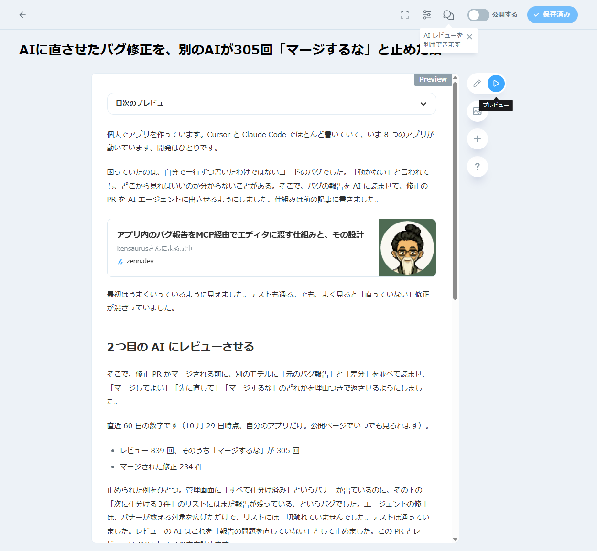
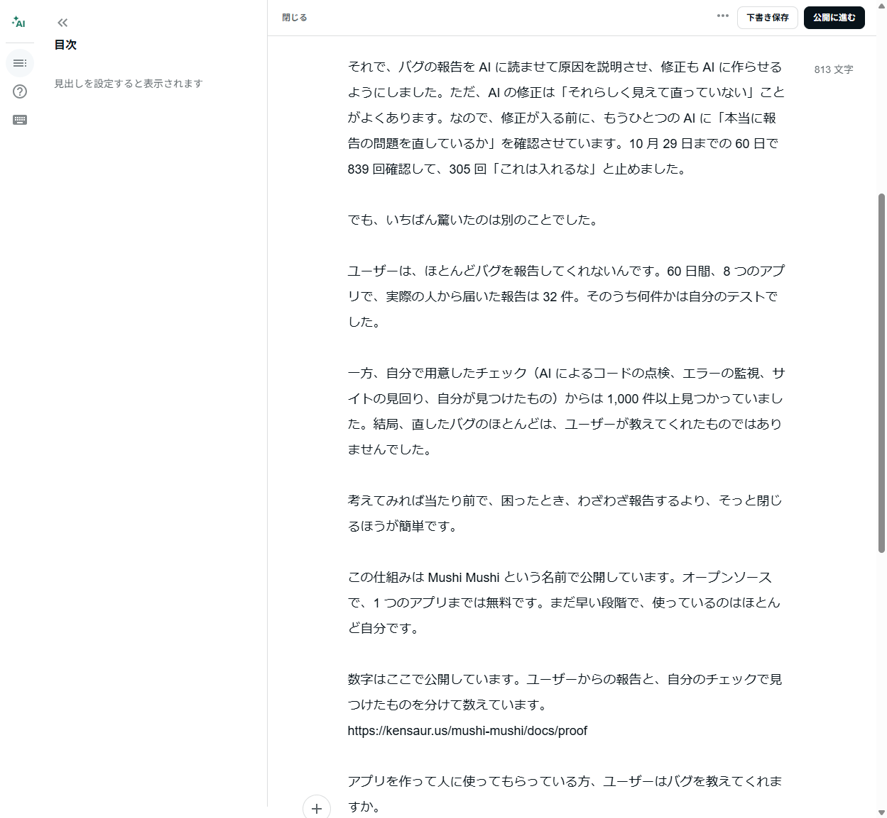

# Launch log: what was posted where

One entry per post: the exact text, a screenshot, the live link. Screenshots are
cropped to the post itself (no feeds, inboxes or subscription lists: this repo is
public). The product name is **Mushi Mushi** (`mushi-mushi`); never shorten it
to "Mushi" in posts.

## 2026-10-29

| Platform | Account | Status | Live URL | Posted at (UTC) |
|---|---|---|---|---|
| Hacker News (Show HN) | kensaurus | **not posted**: HN is "temporarily restricting Show HNs" from new accounts (account created 2026-10-29, karma 1) | | |
| Reddit r/SideProject | u/sakuramoto | posted | https://redd.it/1xi6gtf | 2026-10-29 ~01:20 |
| X | @sakuramotokenji | posted, links reply posted by the owner | https://x.com/sakuramotokenji/status/2115612842812735787 | 2026-10-29 01:13 |
| LinkedIn | kenji sakuramoto | posted | https://www.linkedin.com/in/kenjisakuramoto/recent-activity/all/ (post of 2026-10-29) | 2026-10-29 ~01:25 |
| Zenn (Idea) | kensaurus | **draft**, saved unpublished; topics ai, claudecode, cursor, 個人開発, oss | https://zenn.dev/articles/b7f223e0c9bf5d/edit (editor) | |
| note | kensaurus | **draft**, saved unpublished | https://editor.note.com/notes/n2157e8d303d9/edit/ (editor) | |

Zenn and note are Japanese. Both use the numbers as of 2026-10-29 02:43 UTC
(839 reviews, 305 "do not merge"), a few more than the English posts had. The
Zenn draft links the earlier Zenn article on how the pipeline works
(https://zenn.dev/kensaurus/articles/0c8f927b20adaf, 2026-10-10) instead of
repeating it. Hacker News is set aside for now (owner, 2026-10-29).

### Numbers used, and where they come from

`GET /v1/public/scoreboard` (https://kensaur.us/mushi-mushi/docs/proof), last 60
days, after the 2026-10-29 fix (migration `20261029100000`, PR #893): 8 apps;
32 reports from people on real devices (16 devices, the owner's testing
included); 1,068 found by the owner's own checks (console and API filings, AI
audits and sweeps, imports, Sentry, site checks); 234 fixes merged, 1 of them for
a person's report; 835 AI reviews, 304 "do not merge".

The first drafts of this round (and `../show-hn.md`, `../reddit-vibecoding.md`,
`../x-thread.md`, `../linkedin.md`) used the old page's numbers, which counted
Mushi Mushi's own reports as user reports (676 "from 314 people"). Those were
wrong and were never posted.

The held fix in every post is public: https://github.com/kensaurus/mushi-mushi/pull/864
(the AI review: "Hold: don't merge this as it is").

### Tone

Problem first, in the owner's voice, with what is still rough. No hard sell.
No em dashes, no "Here's what I learned", no emoji hooks, no reflex lists of
three, no "not X but Y", no price pitch. Every claim checked against the data
before posting (2026-10-29: "835 fixes" became 835 reviews; "most of my bugs"
became "a lot of my bugs"; the 32 user reports say some were the owner testing).

### Hacker News (not posted)

HN shows https://news.ycombinator.com/showlim to new accounts: "We're temporarily
restricting Show HNs because of a massive influx… Take some time to get to know
the community, become a good contributor, and then it will be fine to post an
occasional Show HN." Do not repost it as a plain story to get around that. Use
the account for a while, then post this text:

- **Title:** Show HN: Mushi Mushi - AI fixes my apps' bugs, and a second AI reviews every fix
- **URL:** https://github.com/kensaurus/mushi-mushi

```text
Hi HN, I'm Kenji. I build small apps by myself with Cursor and Claude Code. Eight of them are live.

My problem has been bugs in code I didn't write by hand. When something breaks I often don't know where to look. So I started letting agents find and fix bugs, which worked until I noticed some fixes were wrong in ways CI didn't catch.

Mushi Mushi puts a second model in front of every fix PR. It reads the bug report and the diff and decides whether the PR fixes what the report describes. Over the last 60 days on my apps it reviewed 835 times and said "do not merge" 304 times. 234 fixes merged.

One you can read in full: https://github.com/kensaurus/mushi-mushi/pull/864. A banner said everything was triaged while the "Top 3 to triage" list still showed reports. The fix changed what the banner counts and left the list alone. The reviewer held it.

Something I didn't expect: my users almost never report bugs. 32 reports from real people in 60 days, across 8 apps, and some of those were me testing. Nearly everything Mushi Mushi fixed was found by my own checks: AI audits, Sentry, site crawls, and bugs I or my coding agents filed. The live page counts the two separately: https://kensaur.us/mushi-mushi/docs/proof

It's early. I'm most of its users, and setup has more steps than it should. The SDKs are MIT, the server is AGPL, and a separate enterprise folder is source-available: https://github.com/kensaurus/mushi-mushi. There's also a free check you can run on any live site without signing up: https://kensaur.us/mushi-mushi/docs/check?src=hn

If you let agents change your code, how do you decide which fixes to trust?
```

### Reddit, r/SideProject


- **Title:** mushi-mushi - an open-source bug fixer I run on my own apps, where a second AI can refuse the fix
- r/vibecoding was not used: its rule 2 says vibe-coding dev tools need moderator
  approval first, through its X community
  (https://x.com/i/communities/1898129646782497027).

```text
I build small apps on my own with Cursor and Claude Code, eight of them live. I made this because I kept getting stuck on bugs in code I didn't write by hand.

Agents find and fix the bugs, and before anything merges a second model reads the bug report next to the diff and says whether the fix actually fixes it. In 60 days it said "do not merge" 304 times out of 835 reviews. 234 fixes went in.

Here's one it held, public on GitHub: https://github.com/kensaurus/mushi-mushi/pull/864. The bug was a banner saying "all triaged" while the "Top 3 to triage" list still had reports in it. The agent changed what the banner counts and never touched the list.

The thing that surprised me most: real users barely report bugs. 32 reports from people in 60 days, across 8 apps, and some of those were me testing. Almost everything got found by automated checks instead. I put the numbers on a page with the two counted separately: https://kensaur.us/mushi-mushi/docs/proof

Code is here: https://github.com/kensaurus/mushi-mushi. It's rough, and so far I'm most of its users.

Do your users report bugs? Mine mostly don't, and I'm curious whether that's normal.
```

### X


Image: media/ai-review-hold-pr864.png.

```text
I build apps alone with Cursor and Claude Code. Agents fix a lot of my bugs, and a second AI reviews each fix.

60 days: 234 fixes merged. The reviewer said "do not merge" 304 times.

Users reported 32 bugs in that time (some were me testing). My own checks found the rest.
```

Owed: a reply with the links (the post names no link and no product):

```text
It is called Mushi Mushi, and it is open source: https://github.com/kensaurus/mushi-mushi

The held fix in the picture: https://github.com/kensaurus/mushi-mushi/pull/864
Live numbers: https://kensaur.us/mushi-mushi/docs/proof
```

### LinkedIn


Images: media/ai-review-hold-pr864.png, media/sample-diagnosis.png.

```text
I build small apps on my own with AI coding tools, and I run a campsite in the mountains of Gunma. Eight of the apps are live.

For a while the worst part was bugs in code I hadn't written by hand. So I set up agents to find and fix them, with one rule: a second model reads the bug report next to each proposed change and can refuse it.

In the last 60 days that reviewer checked fixes 835 times and said "do not merge" 304 times. 234 fixes went in. One of the refused ones is public if you want to see what that looks like: github.com/kensaurus/mushi-mushi/pull/864

The surprise was where the bugs came from. People using my apps reported 32 in those 60 days, and some of those were me testing. Almost everything else was found by automated checks: AI audits, error monitoring, site crawls. If I had waited for users to tell me, I would have fixed very little.

I packaged this as an open-source tool called mushi-mushi. It is early and I am most of its users. The numbers are live here, with users' reports and my own checks counted separately: kensaur.us/mushi-mushi/docs/proof

Code: github.com/kensaurus/mushi-mushi

The second picture is the sample diagnosis from the docs, to show what a report turns into.
```

### Zenn (draft)



Title: AIに直させたバグ修正を、別のAIが305回「マージするな」と止めた話

```markdown
個人でアプリを作っています。Cursor と Claude Code でほとんど書いていて、いま 8 つのアプリが動いています。開発はひとりです。

困っていたのは、自分で一行ずつ書いたわけではないコードのバグでした。「動かない」と言われても、どこから見ればいいのか分からないことがある。そこで、バグの報告を AI に読ませて、修正の PR を AI エージェントに出させるようにしました。仕組みは前の記事に書きました。
https://zenn.dev/kensaurus/articles/0c8f927b20adaf

最初はうまくいっているように見えました。テストも通る。でも、よく見ると「直っていない」修正が混ざっていました。

## 2つ目の AI にレビューさせる

そこで、修正 PR がマージされる前に、別のモデルに「元のバグ報告」と「差分」を並べて読ませ、「マージしてよい」「先に直して」「マージするな」のどれかを理由つきで返させるようにしました。

直近 60 日の数字です（10 月 29 日時点、自分のアプリだけ。公開ページでいつでも見られます）。

- レビュー 839 回、そのうち「マージするな」が 305 回
- マージされた修正 234 件

止められた例をひとつ。管理画面に「すべて仕分け済み」というバナーが出ているのに、その下の「次に仕分ける3件」のリストにはまだ報告が残っている、というバグでした。エージェントの修正は、バナーが数える対象を広げただけで、リストには一切触れていませんでした。テストは通っていました。レビューの AI はこれを「報告の問題を直していない」として止めました。この PR とレビューは GitHub でそのまま読めます。
https://github.com/kensaurus/mushi-mushi/pull/864

## いちばん意外だったこと

ユーザーはほとんどバグを報告してくれません。60 日間、8 つのアプリで、実際の人からの報告は 32 件でした（しかも一部は自分のテストです）。

一方で、自分で仕掛けたチェック（AI によるコード監査、Sentry、サイトの巡回、自分で書いた報告）から見つかったバグは 1,000 件を超えていました。マージされた修正のうち、ユーザーの報告から始まったものは 1 件だけです。

バグはだいたい報告されません。困った人は、黙って離れていきます。

## いま作っているもの

この仕組みを Mushi Mushi というオープンソースのツールにしています（SDK は MIT、サーバーは AGPL）。アプリに報告ボタンを置くと、報告ごとに原因を平易な言葉で説明して、Cursor や Claude Code にそのまま渡せる修正の指示を作ります。報告を待たずに、初めてのユーザーのふりをして迷う場所を探すテストや、サイトの見守り、既知の脆弱性のチェックもします。

まだ早い段階で、使っているのはほぼ自分です。セットアップの手順も多すぎると思っています。

- コード: https://github.com/kensaurus/mushi-mushi
- 数字（ユーザーの報告と自分のチェックを分けて数えています）: https://kensaur.us/mushi-mushi/docs/proof
- 何ができるか: https://kensaur.us/mushi-mushi/docs/what-it-does

AI に書かせたアプリを人に使ってもらっている方に聞いてみたいです。ユーザーはバグを報告してくれますか。AI の修正、どうやって信用していますか。
```

### note (draft)



Title: ユーザーはバグを報告してくれない。8つのアプリを60日見て分かったこと

```text
群馬県嬬恋村でキャンプ場を運営しながら、AI を使ってアプリを作っています。いま動いているのは 8 つ。家計簿、語学の練習、写真、ひとり法人の決算、キャンプ場の管理まわりなどです。

コードのほとんどは AI が書いています。速く作れるのはいいのですが、困るのはバグが出たときです。自分で書いていないので、どこを見ればいいのか分からない。

それで、バグの報告を AI に読ませて原因を説明させ、修正も AI に作らせるようにしました。ただ、AI の修正は「それらしく見えて直っていない」ことがよくあります。なので、修正が入る前に、もうひとつの AI に「本当に報告の問題を直しているか」を確認させています。10 月 29 日までの 60 日で 839 回確認して、305 回「これは入れるな」と止めました。

でも、いちばん驚いたのは別のことでした。

ユーザーは、ほとんどバグを報告してくれないんです。60 日間、8 つのアプリで、実際の人から届いた報告は 32 件。そのうち何件かは自分のテストでした。

一方、自分で用意したチェック（AI によるコードの点検、エラーの監視、サイトの見回り、自分が見つけたもの）からは 1,000 件以上見つかっていました。結局、直したバグのほとんどは、ユーザーが教えてくれたものではありませんでした。

考えてみれば当たり前で、困ったとき、わざわざ報告するより、そっと閉じるほうが簡単です。

この仕組みは Mushi Mushi という名前で公開しています。オープンソースで、1 つのアプリまでは無料です。まだ早い段階で、使っているのはほとんど自分です。

数字はここで公開しています。ユーザーからの報告と、自分のチェックで見つけたものを分けて数えています。
https://kensaur.us/mushi-mushi/docs/proof

アプリを作って人に使ってもらっている方、ユーザーはバグを教えてくれますか。
```

## Images

All are screenshots of public pages, so anyone can open the original.

| File | What it shows | Original |
|---|---|---|
|  | The AI review on mushi-mushi PR #864: "Hold: don't merge this as it is" | https://github.com/kensaurus/mushi-mushi/pull/864 |
|  | The docs' sample diagnosis (labelled SAMPLE on the page and in the LinkedIn text) | https://kensaur.us/mushi-mushi/docs/demo/diagnosis |
|  | **Wrong numbers, not used**: /proof before the fix (676 "from 314 people") | kept as a record of the error |

The draft screenshots (`2026-10-29-*-draft*.png`) show earlier drafts; the live
screenshots above are what went out.
