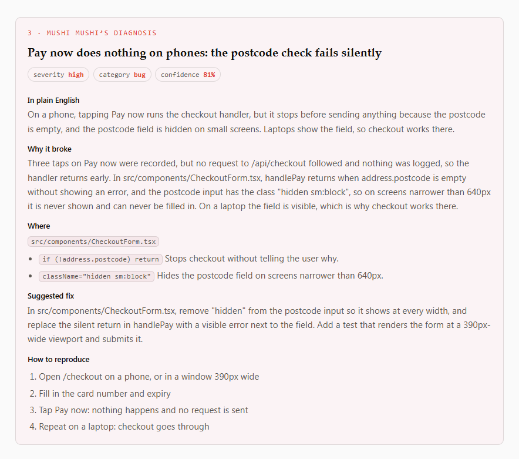

<div align="center">

# Mushi Mushi

> **Your AI built it. Mushi Mushi makes it better.**

One place to improve your AI-built app. Mushi Mushi finds what breaks, where people get stuck and what the code needs. Then it hands the fix to Lovable, Cursor or Claude Code, in plain English.

```bash
npx mushi-mushi
```

Run it in your app's folder. No terminal? [Use Lovable or Bolt instead](https://kensaur.us/mushi-mushi/docs/quickstart/lovable-bolt).

[](https://www.npmjs.com/package/mushi-mushi)
[](https://www.npmjs.com/package/mushi-mushi)
[](https://github.com/kensaurus/mushi-mushi/blob/master/LICENSE)
[](https://docs.npmjs.com/generating-provenance-statements)

<a href="https://kensaur.us/mushi-mushi/docs/demo/diagnosis" title="See a sample diagnosis: no signup">
  
</a>

<sub>↑ What you get back when a user writes "Pay now does nothing on my phone". [Read the whole sample](https://kensaur.us/mushi-mushi/docs/demo/diagnosis), no signup.</sub>

</div>

---

## What happens next

1. **You sign in through your browser.** The command opens a page. You approve it, and Mushi Mushi makes your free project and key. There is nothing to copy.
2. **It installs Mushi Mushi and shows you a few lines of code.** Add them to your app (or ask your AI editor to). They show a small report button.
3. **Your users tap the button when something is wrong.** They write one sentence. Mushi Mushi adds a screenshot and what the app was doing.
4. **You get the cause in plain English, and a fix your AI editor can apply.** Open the report in the [console](https://kensaur.us/mushi-mushi/admin), or ask your editor for it.

The setup adds `mushi-mushi` to your `package.json` and writes your two settings to `.env.local`. It doesn't change your app's code (for a plain JavaScript app it offers to, and asks first). It warns you if `.env.local` is not in `.gitignore`.

## What it does

| | What you get | What it needs |
| --- | --- | --- |
| **Fix what breaks** | A report button for your users, and a plain-English diagnosis of each bug with a fix prompt. Repeat reports of one bug become one row. | Nothing extra. |
| **Smooth user journeys** | A map of how people move through your app: where they leave, get lost or hit a dead end, each with a prompt for your AI editor. | The map from real visits needs nothing extra. A scan of your live site needs a [Firecrawl](https://www.firecrawl.dev) key. |
| **Clean up the code** | Known security holes in your packages, and [lint rules](#catch-what-ai-tools-leave-behind) that catch empty buttons and fake data. Changes come as pull requests you review. | GitHub connected, for the security check. |

More detail on each: [what it does](https://kensaur.us/mushi-mushi/docs/what-it-does).

## Ask your AI editor to do it

Paste this into Cursor, Claude Code or any AI editor that can run commands:

```text
Add Mushi Mushi to this app. In the project folder, run `npx mushi-mushi --yes`.
It prints a sign-in link: show it to me and wait while I approve it in my
browser. Then add the code it prints to the file it names, and tell me which
file you changed.
```

Then connect your editor so it can read reports: `npx mushi-mushi setup --ide cursor` (or `claude`). Ask it: *"Get the latest Mushi Mushi report and fix it."* There is also a one-click button on the [connect page](https://kensaur.us/mushi-mushi/docs/connect).

## Set it up by hand

`npm install mushi-mushi`, then add the import for your framework. Your project ID and key are on the console's **Set up** page.

| Your app | Install | Import from |
| --- | --- | --- |
| React, Next.js, Remix | `mushi-mushi` | `mushi-mushi/react` |
| Vue, Nuxt | `mushi-mushi` | `mushi-mushi/vue` |
| Svelte, SvelteKit | `mushi-mushi` | `mushi-mushi/svelte` |
| Angular 17+ | `mushi-mushi` | `mushi-mushi/angular` |
| Astro, Solid, plain JavaScript | `mushi-mushi` | `mushi-mushi` |
| Node (Express, Fastify, Hono) | `mushi-mushi` | `mushi-mushi/node` |
| React Native, Expo | `@mushi-mushi/react-native` | `@mushi-mushi/react-native` |
| Capacitor, Ionic | `@mushi-mushi/capacitor` | `@mushi-mushi/capacitor` |

Step-by-step for each one: [quickstarts](https://kensaur.us/mushi-mushi/docs/quickstart). `mushi-mushi` never installs a framework you don't use.

## Start a new app with it

To begin from nothing, make a small starter app with Mushi Mushi already in it:

```bash
npx mushi-mushi --template vue my-app   # or: svelte, node
```

## Catch what AI tools leave behind

`mushi-mushi/eslint` adds lint rules for two things AI tools often ship: buttons whose click does nothing, and placeholder data (John Doe, lorem ipsum) left in real pages.

```js
// eslint.config.js
import mushi from 'mushi-mushi/eslint'

export default [mushi.configs.recommended]
```

[The rules, with examples](https://kensaur.us/mushi-mushi/docs/sdks/eslint-plugin).

## Free to start

The free plan covers one app and 100 diagnoses a month, with no card and no AI key of your own. Repeat reports of one bug count once. [Pricing](https://kensaur.us/mushi-mushi/docs/pricing).

You don't need Sentry or any monitoring tool. If you have one, Mushi Mushi can read its errors too.

<details>
<summary><b>For developers: flags, CI, self-hosting and the full CLI</b></summary>

```bash
npx mushi-mushi --framework next      # skip framework detection
npx mushi-mushi --cwd apps/web        # run inside a monorepo package
npx mushi-mushi --skip-install        # print the install command instead
npx mushi-mushi --audit               # health-check an existing install
npx mushi-mushi --endpoint https://mushi.your-company.com   # self-hosted
npx mushi-mushi -y --project-id <uuid> --api-key mushi_xxx  # CI, no prompts
npx mushi-mushi --help
```

Any other command goes to the full CLI, so `npx mushi-mushi reports list` works. It needs Node 20.19 or newer.

- [Every flag, troubleshooting and security notes](https://kensaur.us/mushi-mushi/docs/sdks/launcher)
- [The full CLI](https://kensaur.us/mushi-mushi/docs/sdks/cli) (`npm i -g @mushi-mushi/cli` for a `mushi` command)
- [Integrations](https://kensaur.us/mushi-mushi/docs/plugins): Sentry, Slack, Linear, Jira, GitHub Issues and more
- [Self-hosting](https://kensaur.us/mushi-mushi/docs/self-hosting)
- More entry points: `mushi-mushi/headless`, `/i18n`, `/otel`, `/test-utils`, `/core` (types)

Already on `@mushi-mushi/react`, `@mushi-mushi/web` or another `@mushi-mushi/*` package? It keeps working and keeps getting updates. `mushi-mushi` ships the same code, so you can switch by changing the import path.

</details>

## Links

- [Docs](https://kensaur.us/mushi-mushi/docs/): quickstarts and guides
- [Sample diagnosis](https://kensaur.us/mushi-mushi/docs/demo/diagnosis): one bug from report to fix, no signup
- [Live numbers](https://kensaur.us/mushi-mushi/docs/proof): what Mushi Mushi found and fixed on the maker's own apps
- [GitHub](https://github.com/kensaurus/mushi-mushi): source code
- [Report a bug](https://github.com/kensaurus/mushi-mushi/issues) in Mushi Mushi itself

## License

MIT © [Kenji Sakuramoto](https://github.com/kensaurus). The server packages are [AGPLv3](https://github.com/kensaurus/mushi-mushi/blob/master/packages/server/LICENSE).

## More apps from the same maker

| | App | What it is |
|---|---|---|
|  | [Glot It](https://kensaur.us/glot-it/?utm_source=github&utm_medium=readme) | Learn Thai — bite-size lessons, smart flashcards, and an AI tutor |
|  | [yen-yen](https://kensaur.us/yen-yen/?utm_source=github&utm_medium=readme) | Where did the money go? Now you'll know. A kakeibo for households |
|  | [The Wanting Mind](https://kensaur.us/the-wanting-mind/?utm_source=github&utm_medium=readme) | How the Battle Between Extraction and Generation Is Reshaping Our World — a 147,000-word interactive webbook with 268 concepts, 242 citations, and original illustrations |
|  | [Help Her Take Photo](https://kensaur.us/help-her-take-photo/?utm_source=github&utm_medium=readme) | Pair phones, direct the pose, nail the photo |
|  | [Cooler Heads](https://talk.kensaur.us/?utm_source=github&utm_medium=readme) | Practice hard conversations before you have them |
|  | [一人社長 Solo Boss](https://solo-boss.kensaur.us/?utm_source=github&utm_medium=readme) | Bookkeeping and tax-filing co-pilot for one-person companies in Japan |
|  | [Tsumagoi Work&Camp 嬬恋牧場](https://tsumagoi.kensaur.us/?utm_source=github&utm_medium=readme) | Coworking camp at 1,444 m — [Instagram](https://www.instagram.com/tsumagoicamp/) · [Facebook](https://www.facebook.com/profile.php?id=61592113053042) · [Maps](https://maps.app.goo.gl/JCNnTfsdQVHCS1FA7) |
|  | [kenji skills](https://github.com/kensaurus/skills) | Agent skills and slash commands for Claude Code, Cursor, Codex, and Gemini |
|  | [kensaur.us](https://kensaur.us/?view=portfolio&utm_source=github&utm_medium=readme) | All apps from the same maker |

All apps live under [kensaur.us](https://kensaur.us).
